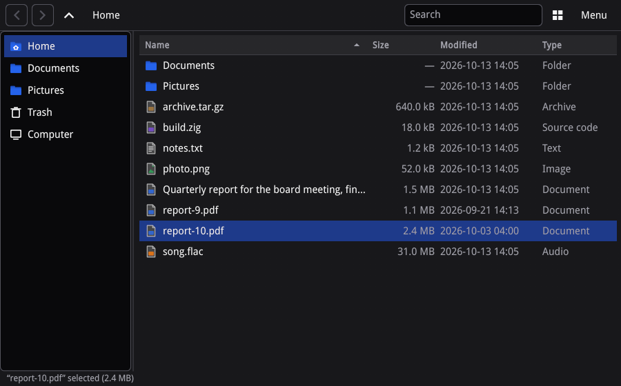

# siv

A fast, native GUI toolkit for Linux desktops on Wayland. Write your
application in Lua, C, Zig, or any language that can call C.



*[apps/files](apps/files), a file manager written against siv's public API.*

## Why siv

- **It starts fast and stays light.** An idle window shows its first frame
  in about 26 ms and holds 48 MiB of memory. GTK 4, Qt Quick, and gpui take
  60 to 75 ms and hold 65 to 85 MiB. Scrolling and animation run on their
  own thread, so a busy application does not stutter, and an idle
  application never wakes up. [The benchmarks](bench/gpui-compare/README.md)
  have the numbers and how they were measured.
- **It looks like the user's desktop.** siv follows the desktop's light or
  dark scheme, contrast, and accent color, and repaints live when they
  change. Users can theme every siv application at once with
  `~/.config/siv/theme.toml`, which tools like matugen and pywal can write,
  and siv picks up Omarchy's theme on its own.
- **The stock widgets are complete.** Buttons, fields, a real text editor,
  lists and tables that scroll through 100,000 rows, trees, menus, and
  dialogs. Every widget works from the keyboard, with input methods, and
  with screen readers through AT-SPI.
- **It talks to the desktop.** File choosers and settings through
  xdg-desktop-portal, notifications, a tray item, printing and PDF, D-Bus
  activation, and Flatpak packaging.
- **You pick the language.** Lua for scripts and quick iteration, with
  reload on save. C, since the ABI is C, and a native Zig API. Rust
  through bindgen. Every binding is generated from one schema, so they
  stay in step.
- **It is one library.** No GLib or Qt runtime underneath, and MIT
  licensed.
- **You can test without a display.** The headless backend drives your
  application like a user and compares what it shows, in CI.

## Hello, world

The quickest way in is Lua, since only siv itself needs building:

```lua
local siv = require("siv")

local app = siv.app_create()
local win = app:window_create{ title = "Hello", width = 320, height = 160 }

local clicks = 0
local label

win:update(function(txn, root)
	txn:set_visual(root, { background_token = "window_bg" })
	local column = txn:flex(root, { axis = "column", gap = 12, align_items = "start" }, {
		layout = { padding = 24 },
	})
	txn:text(column, "Hello, siv", {
		text_style = { size_role = "title", weight = "bold", color_token = "window_fg" },
		semantics = { role = "heading", level = 1 },
	})
	txn:push_button(column, { label = "Click me", style = "primary" }, {
		on = {
			activate = function(_, ev)
				clicks = clicks + 1
				ev.window:update(function(t)
					t:set_text(label, ("Clicked %d time%s"):format(clicks, clicks == 1 and "" or "s"))
				end)
				return true
			end,
		},
	})
	label = txn:text(column, "Not clicked yet", { text_style = { color_token = "window_fg" } })
end)

app:run()
```


You build the window's tree inside `update`, which is a transaction: all of
it appears at once, or none of it if the function raises. The button is a
stock widget, so it already follows the theme, takes focus with Tab, and
announces itself to screen readers. The handler runs on your thread and
changes the label in a second transaction.

## Get started

1. **Install the build dependencies:** [Zig 0.17.0](https://ziglang.org/download/)
   and the development files for Wayland, xkbcommon, Fontconfig, and the
   Vulkan headers.

   ```sh
   sudo apt install libwayland-dev libxkbcommon-dev libfontconfig-dev libvulkan-dev   # Debian, Ubuntu
   sudo dnf install wayland-devel libxkbcommon-devel fontconfig-devel vulkan-headers  # Fedora
   sudo pacman -S wayland libxkbcommon fontconfig vulkan-headers                      # Arch
   ```

   `zig build` fetches and builds everything else (HarfBuzz, the image
   decoders, Lua); `-fsys=<name>` links the system's copy instead.

2. **Build siv:**

   ```sh
   git clone https://github.com/rockorager/siv
   cd siv
   zig build -Doptimize=ReleaseSafe
   ```

3. **Run the hello world.** Save it as `hello.lua` and run it with
   `--watch`, which reloads the window every time you save:

   ```sh
   ./zig-out/bin/siv-lua --watch hello.lua
   ```

4. **Try the examples:** `examples/todo.lua`, `examples/widgets.lua`, and
   `examples/viewer.lua` with `siv-lua`; `zig build examples` builds the C
   ones into `zig-out/bin/`.

5. **Install it** when you want to build against it from your own
   projects: `zig build -Doptimize=ReleaseSafe --prefix /usr/local`. That
   installs `libsiv.so`, `siv.h`, `siv.pc`, `siv-lua`, and the Lua module.

At run time siv needs a Wayland compositor, libwayland-client, xkbcommon,
and Fontconfig. It renders with Vulkan when a driver is installed and on
the CPU when not.

## Your language

### Lua

siv's Lua binding is for Lua 5.5. Run scripts with `siv-lua`, load
`zig-out/lib/lua/5.5/siv.so` from your own Lua with `require("siv")`, or
embed Lua in a C program with `siv_lua.h` (`pkg-config siv-lua`).
Annotations for lua-language-server are in `zig-out/share/siv/lua/siv.lua`.

### C

The ABI is C11: `siv.h`, `libsiv.so`, and pkg-config.

```sh
cc hello.c $(pkg-config --cflags --libs siv) -o hello
```

[docs/guide/examples/hello.c](docs/guide/examples/hello.c) is the window
above in C, and [Getting started](docs/guide/01-getting-started.md) walks
through it.

### Zig

siv is a Zig package with a Zig API: errors, slices, enums, and packed
flags.

```sh
zig fetch --save git+https://github.com/rockorager/siv
```

```zig
const siv = b.dependency("siv", .{ .target = target, .optimize = optimize });
exe.root_module.addImport("siv", siv.module("siv"));
```

[Getting started](docs/guide/01-getting-started.md#zig) has the complete
`build.zig`, and [docs/guide/examples/zig-package](docs/guide/examples/zig-package)
is a working package.

### Rust and others

[examples/rust](examples/rust) is the hello world in Rust, with bindgen
over `siv.h`. For other languages, `zig-out/share/siv/siv.json` describes
every function, type, and constant, so a binding can be generated instead
of parsing the header.

## Put the web in your app

siv-webview embeds web pages with WPE WebKit, as a separate library beside
libsiv. Your application can serve its own pages, run scripts in them, and
pass messages both ways, so part of the interface can be HTML:

```lua
local siv = require("siv")
local webview = require("siv.webview")

local app = siv.app_create()
local win = app:window_create{ title = "Hybrid", width = 800, height = 600 }

-- Serve the page from Lua; the page answers with siv.postMessage.
webview.register_scheme(app, "app", function(req)
	req:finish([[<h1>Hello from HTML</h1>
<button onclick="siv.postMessage({clicked: true})">Tell Lua</button>]], "text/html")
end)

local wv = webview.create(win, {
	on = { message = function(_, ev) print("the page says " .. ev.text) end },
})

win:update(function(txn, root)
	local page = wv:view(txn, root)
	txn:set_layout(page, { width = { "fraction", 1 }, height = { "fraction", 1 } })
end)

wv:load_uri("app://hello/index.html")
app:run()
```

```sh
./zig-out/bin/siv-webview-lua hybrid.lua
./zig-out/bin/siv-webview-browser https://example.com   # a small browser, from examples/
```

`zig build` builds siv-webview when it finds WPE WebKit 2.50 or later
(Arch: `wpewebkit`). [docs/webview.md](docs/webview.md) has the C API, what
it needs at run time, and measurements.

## Learn more

The [guide](docs/guide/README.md) goes from a first window to a shipped
application, with every sample in C, Zig, or Lua built and checked by
`zig build test`:

1. [Getting started](docs/guide/01-getting-started.md)
2. [How siv works](docs/guide/02-model.md)
3. [Layout and text](docs/guide/03-layout-and-text.md)
4. [Stock widgets and theming](docs/guide/04-widgets-and-theming.md)
5. [Events and focus](docs/guide/05-events-and-focus.md)
6. [Custom widgets](docs/guide/06-custom-widgets.md)
7. [Images and icons](docs/guide/07-images-and-icons.md)
8. [Lists, tables, and trees](docs/guide/08-lists-and-tables.md)
9. [Work off the UI thread](docs/guide/09-async.md)
10. [Clipboard and drag and drop](docs/guide/10-clipboard-and-dnd.md)
11. [Accessibility](docs/guide/11-accessibility.md)
12. [Embedding siv in another event loop](docs/guide/12-embedding.md)
13. [External surfaces and video](docs/guide/13-external-content.md)
14. [Printing and PDF](docs/guide/14-printing.md)
15. [Packaging](docs/guide/15-packaging.md)
16. [Performance](docs/guide/16-performance.md)
17. [Testing](docs/guide/17-testing.md)

The reference for every function and type is generated into
`zig-out/share/doc/siv/siv.md`. [DESIGN.md](DESIGN.md) records why siv is
built the way it is.

## Contributing

[AGENTS.md](AGENTS.md) has the module layout, the build and test commands,
and the rules for changes. `zig build test -j16` runs every test.

## License

siv is released under the MIT license; see [LICENSE](LICENSE). The
licences of the libraries compiled into libsiv are installed with it as
`share/licenses/siv/NOTICES`. libsiv-webview is MIT too: it links WPE
WebKit and GLib (LGPL-2.1-or-later) from the system, dynamically, and
contains none of their code.

The name comes from Coheed and Cambria's *Good Apollo, I'm Burning Star IV*.
