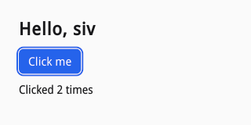

# Getting started

## What you need

siv runs on Linux under a Wayland compositor; there is no X11 backend. To
build it you need Zig 0.17.0 and the development files of
libwayland-client, xkbcommon, Fontconfig, and the Vulkan headers (on Debian:
`libwayland-dev libxkbcommon-dev libfontconfig-dev libvulkan-dev`). Every
other dependency (HarfBuzz, the image decoders, Lua) is fetched and built by
`zig build`; each has a `-fsys=<name>` option to link the system's copy
instead.

At run time siv needs libwayland-client, xkbcommon, and Fontconfig, and uses
the Vulkan loader if one is installed. It talks to the desktop through
xdg-desktop-portal (settings, file choosers, printing) and works without it,
with defaults.

## Building and installing siv

```sh
zig build -Doptimize=ReleaseSafe --prefix /usr/local
```

That installs, under the prefix:

| Path | What |
| --- | --- |
| `lib/libsiv.so.0`, `lib/libsiv.a` | The library |
| `include/siv.h` | The C header |
| `lib/pkgconfig/siv.pc` | For pkg-config |
| `share/siv/siv.zig` | The Zig API |
| `share/siv/siv.json` | The API as data, for other binding generators |
| `share/doc/siv/siv.md` | The reference |
| `lib/libsiv-lua.so`, `bin/siv-lua`, `lib/lua/5.5/siv.so` | The Lua binding and runner |
| `share/siv/lua/siv.lua` | Lua annotations for lua-language-server |
| `share/licenses/siv/NOTICES` | The licences of everything libsiv contains |

Without `--prefix` everything goes to `zig-out/`, which is enough to try the
samples.

## C

`siv.pc` gives the compiler and linker flags:

```sh
cc hello.c $(pkg-config --cflags --libs siv) -o hello
```

With siv in `zig-out/`, point pkg-config there:
`PKG_CONFIG_PATH=zig-out/lib/pkgconfig`. The `.pc` file is relocatable.
For a static link, use `pkg-config --static` and `libsiv.a`, which carries
everything but the system libraries.

siv.h is C11. Every function returns a `siv_result` or a handle, so there
is nothing to initialize globally and nothing to free but what you create.

## Zig

siv is a Zig package. Add it with `zig fetch --save <url of a siv
release>`, then import the `siv` module, which is the Zig API generated
from the same schema as siv.h and linked against libsiv.so:

```zig
const siv = b.dependency("siv", .{ .target = target, .optimize = optimize });
const exe = b.addExecutable(.{
    .name = "hello",
    .root_module = b.createModule(.{
        .root_source_file = b.path("src/main.zig"),
        .target = target,
        .optimize = optimize,
        .link_libc = true,
        .imports = &.{.{ .name = "siv", .module = siv.module("siv") }},
    }),
});
b.installArtifact(exe);
```

[examples/zig-package](examples/zig-package/) is a complete package that
depends on the siv checkout it lives in. With siv installed system-wide
instead, import `share/siv/siv.zig` from its prefix and link the system
library `siv`.

## Lua

siv's Lua binding is for Lua 5.5. Three ways to use it:

- `siv-lua app.lua` runs a program with a Lua built into libsiv-lua, and
  `siv-lua --watch app.lua` reloads it when you save (see
  [Async](09-async.md#hot-reload)).
- A program that already embeds Lua 5.5 loads `siv.so` with
  `require("siv")`; it is on the default `package.cpath` under the prefix,
  or set `LUA_CPATH='zig-out/lib/lua/5.5/?.so'`.
- A C program without a Lua of its own links libsiv-lua (`pkg-config
  siv-lua`) and calls `siv_lua_new` and `siv_lua_run` from `siv_lua.h`.

Nothing is global: everything comes from `local siv = require("siv")`.

## A first window

The program below opens a window with a title, a button, and a label that
counts clicks.


It starts by creating the application, which owns the event loop, the
worker threads, fonts, and the connection to the compositor, and a window:

```c
siv_app app;
siv_result r = siv_app_create(NULL, &app);
if (r != SIV_OK) {
	fprintf(stderr, "hello: %s\n", siv_result_name(r));
	return 1;
}
siv_window window = 0;
struct counter counter = {0};
siv_txn txn = 0;
r = siv_window_create(app, SIV_DESC(siv_window_desc, .title = SIV_STR("Hello"), .width = 320, .height = 160), &window);
```

`, strlen()` is a two-line macro the samples define: siv takes strings as a
pointer and a length, so `SIV_STR("Hello")` expands to `"Hello", strlen("Hello")`.
Descriptor structs like `siv_window_desc` are passed with `SIV_DESC`, which
sets their `size` field; fields you leave out are zero, and zero always
means the default.

The window's content is a tree of nodes, built in a transaction:

```c
if (r == SIV_OK) r = siv_txn_begin(window, &txn);
if (r == SIV_OK) {
	siv_node root = siv_window_get_root(window);
	siv_set_visual(txn, root, SIV_DESC(siv_visual_desc, .background_token = SIV_COLOR_TOKEN_WINDOW_BG));
	siv_node column = siv_flex(txn, root, SIV_DESC(siv_flex_desc, .axis = SIV_AXIS_COLUMN, .gap = 12, .align_items = SIV_ALIGN_START));
	siv_set_layout(txn, column, SIV_DESC(siv_layout_desc, .padding = {24, 24, 24, 24}));

	siv_node title = siv_text(txn, column, SIV_STR("Hello, siv"));
	siv_set_text_style(txn, title, SIV_DESC(siv_text_style_desc, .size_role = SIV_SIZE_ROLE_TITLE, .weight = SIV_FONT_WEIGHT_BOLD, .color_token = SIV_COLOR_TOKEN_WINDOW_FG));
	siv_set_semantics(txn, title, SIV_DESC(siv_semantics_desc, .role = SIV_ROLE_HEADING, .level = 1));

	siv_node button = siv_push_button(txn, column, SIV_DESC(siv_button_desc, .label = SIV_STR("Click me"), .style = SIV_BUTTON_STYLE_PRIMARY));
	siv_on(txn, button, SIV_EVENT_TYPE_ACTIVATE, on_click, NULL, &counter);

	counter.label = siv_text(txn, column, SIV_STR("Not clicked yet"));
	siv_set_text_style(txn, counter.label, SIV_DESC(siv_text_style_desc, .color_token = SIV_COLOR_TOKEN_WINDOW_FG));
	/* Nothing above was checked: the first failure would have made
	 * the rest do nothing, and commit reports it. */
	r = siv_txn_commit(txn);
}
```

Each builder (`siv_flex`, `siv_text`, `siv_push_button`) appends a node to
a parent and returns its handle. None of those calls is checked: if one
fails, the rest do nothing and `siv_txn_commit` reports the first error and
discards the whole transaction, so the window never shows half a tree.

The button's handler runs when it is clicked or activated from the
keyboard, and changes the label in a transaction of its own:

```c
static siv_event_result on_click(void *user_data, siv_node button, const siv_event *event) {
	(void)button;
	struct counter *counter = user_data;
	counter->clicks++;
	char text[32];
	snprintf(text, sizeof text, "Clicked %d time%s", counter->clicks, counter->clicks == 1 ? "" : "s");
	siv_txn txn;
	if (siv_txn_begin(event->window, &txn) != SIV_OK) return SIV_EVENT_RESULT_PASS;
	siv_set_text(txn, counter->label, text, strlen(text));
	return siv_txn_commit(txn) == SIV_OK ? SIV_EVENT_RESULT_HANDLED : SIV_EVENT_RESULT_PASS;
}
```

Finally, `siv_app_run` dispatches events until the last window closes:

```c
if (r == SIV_OK) r = siv_app_run(app);
if (r != SIV_OK) fprintf(stderr, "hello: %s\n", siv_result_name(r));
siv_app_destroy(app);
return r == SIV_OK ? 0 : 1;
```

The window looks like this after two presses of Enter, with the focus ring
siv draws when focus moves by keyboard:



### The same in Zig

The Zig API has the same functions, named in camel case without the
prefix. Functions that return `siv_result` return Zig errors instead, and
out parameters become return values:

```zig
pub fn main() !void {
    const app = try siv.appCreate(null);
    defer siv.appDestroy(app);
    const title = "Hello";
    const window = try siv.windowCreate(app, &.{ .title = title, .title_len = title.len, .width = 320, .height = 160 });
    var counter: Counter = .{};
    try build(window, &counter);
    try siv.appRun(app);
}
```

Builders still return a node (0 after a failure) and setters an error, so
Zig code `try`s each setter and aborts the transaction with `errdefer`:

```zig
fn build(window: siv.Window, counter: *Counter) !void {
    const txn = try siv.txnBegin(window);
    errdefer siv.txnAbort(txn);
    const root = siv.windowGetRoot(window);
    siv.setVisual(txn, root, &.{ .background_token = .window_bg });
    const column = siv.flex(txn, root, &.{ .axis = .column, .gap = 12, .align_items = .start });
    siv.setLayout(txn, column, &.{ .padding = .{ .start = 24, .end = 24, .top = 24, .bottom = 24 } });

    const title = siv.text(txn, column, "Hello, siv");
```

Callbacks are C functions (`callconv(.c)`); the event pointer is optional
in the generated types, though siv always passes one:

```zig
fn onClick(user_data: ?*anyopaque, _: siv.Node, event: ?*const siv.Event) callconv(.c) siv.EventResult {
    const counter: *Counter = @ptrCast(@alignCast(user_data));
    counter.clicks += 1;
    var buf: [32]u8 = undefined;
    const label = std.fmt.bufPrint(&buf, "Clicked {d} time{s}", .{ counter.clicks, if (counter.clicks == 1) "" else "s" }) catch unreachable;
    const txn = siv.txnBegin(event.?.window) catch return .pass;
    siv.setText(txn, counter.label, label);
    siv.txnCommit(txn) catch {};
    return .handled;
}
```

### The same in Lua

```lua
local siv = require("siv")

local app = siv.app_create()
local win = app:window_create{ title = "Hello", width = 320, height = 160 }

local clicks = 0
local label

win:update(function(txn, root)
	txn:set_visual(root, { background_token = "window_bg" })
	local column = txn:flex(root, { axis = "column", gap = 12, align_items = "start" }, {
		layout = { padding = 24 },
	})
	txn:text(column, "Hello, siv", {
		text_style = { size_role = "title", weight = "bold", color_token = "window_fg" },
		semantics = { role = "heading", level = 1 },
	})
	txn:push_button(column, { label = "Click me", style = "primary" }, {
		on = {
			-- Runs on the application's thread when the button is clicked,
			-- or activated with Enter, Space, or a screen reader.
			activate = function(_, ev)
				clicks = clicks + 1
				ev.window:update(function(t)
					t:set_text(label, ("Clicked %d time%s"):format(clicks, clicks == 1 and "" or "s"))
				end)
				return true
			end,
		},
	})
	label = txn:text(column, "Not clicked yet", { text_style = { color_token = "window_fg" } })
end)

app:run()
```

Builders take a trailing table of properties, each naming a setter
(`layout`, `visual`, `text_style`, `semantics`) or handlers under `on`, so a
node is one call. `win:update(fn)` runs `fn(txn, root)` in a transaction
and commits it, or aborts it if `fn` raises. Errors are raised, not
returned.

## One API, three languages

The Zig and Lua bindings are generated from one schema (D3), so any C
function maps to the others by rule:

| | C | Zig | Lua |
| --- | --- | --- | --- |
| Function | `siv_window_set_title(w, t, len)` | `siv.windowSetTitle(w, t)` | `w:set_title(t)` or `siv.window_set_title(w, t)` |
| Builder | `siv_flex(txn, parent, &desc)` | `siv.flex(txn, parent, &desc)` | `txn:flex(parent, desc, props)` |
| Descriptor | `SIV_DESC(siv_flex_desc, .gap = 8)` | `&.{ .gap = 8 }` | `{ gap = 8 }` |
| Enum | `SIV_AXIS_COLUMN` | `.column` | `"column"` |
| Flags | `SIV_TEXT_NO_WRAP \| SIV_TEXT_ELLIPSIZE` | `.{ .no_wrap = true, .ellipsize = true }` | `{ "no_wrap", "ellipsize" }` |
| String | pointer and length | slice (descriptors: `.f` and `.f_len`) | string |
| Failure | `siv_result` below 0 | `error.Busy` and the like | raises `{ code = "busy", ... }` |
| Out value | trailing pointer | return value | return value |
| Callback | function pointer, `void *user_data` | `callconv(.c)` function | Lua function |

In Lua, a function is a method of the handle type of its first parameter,
with that type's name dropped: `siv_node_focus(n)` is `n:focus()`,
`siv_view_get_cursor(v)` is `v:view_get_cursor()`. Colors also take CSS strings
(`"#2563eb"`), and edges, corners, and sizes take one number for all
sides. The Zig API also exports the raw C functions as `siv.c.siv_*`, for
code that prefers C's sticky transaction errors to a `try` on every
setter.
