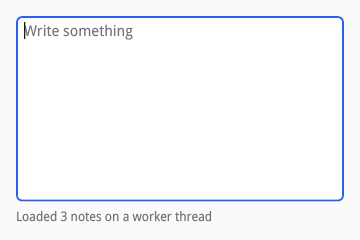
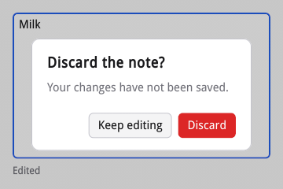

# How siv works

A siv program has an application, which has windows, each of which has a
tree of nodes. You change a tree in transactions. siv calls you back only
at safe points on your thread, and draws on a thread of its own. This
chapter walks through those pieces with [examples/model.c](examples/model.c),
a note editor that loads on a worker thread and asks before closing with
unsaved changes.



## The application

`siv_app_create` makes an application: an event loop, a pool of worker
threads, the fonts, the clipboard, the connection to the compositor, and a
thread that renders. Everything in siv is reached through handles it
issues, plain 64-bit numbers checked on every call: a handle to something
destroyed is an error (`SIV_ERROR_INVALID_HANDLE`), never a crash.
Destroying the application destroys everything it made. There is no global
state, so a process may hold several applications.

Every call on an application must come from the thread that created it.
The header and the reference mark each function's thread; the exceptions
are few: `siv_post` (below), and the calls that hand frames to
[external content](13-external-content.md). Callbacks are marked the same
way: nearly all run on the application's thread, and the few that do not
(a job's work, an external frame's release) say so.

## Windows

`siv_window_create` makes a toplevel window. It appears once its first
frame is ready, so build its tree right away. A window reports what
happens to it through `on_event` in its descriptor: a close request, a new
size or scale, state changes, and frames reaching the screen
(`SIV_WINDOW_EVENT_TYPE_PRESENTED`, see [Performance](16-performance.md)).

A close request destroys the window unless the handler returns true. The
note editor keeps the window and asks first when there are unsaved
changes:

```c
/* Window events: returning true from a close request keeps the window. */
static bool on_window_event(void *user_data, siv_window window, const siv_window_event *event) {
	(void)window;
	struct notes *notes = user_data;
	if (event->type == SIV_WINDOW_EVENT_TYPE_CLOSE_REQUESTED && notes->dirty) {
		ask_to_discard(notes);
		return true;
	}
	return false;
}
```

`siv_app_run` returns when the last window is destroyed or `siv_app_quit` is
called. Destroying a window from its own handler is fine; so is destroying
the window a callback is running for. Popups (menus, popovers) are windows
too, made with `siv_popup_create` or the widgets that use it.

## The retained tree

A window's content is a tree of nodes that persists between frames. Each
node has a kind, fixed when it is made: a container (`siv_box`, `siv_flex`,
`siv_grid`, `siv_stack`, `siv_scroll`), text (`siv_text`), an editor
(`siv_editor`), an image (`siv_image_view`), a canvas you draw on
(`siv_canvas`), or external content (`siv_external_view`). Stock widgets
are built from these same nodes by public functions, so a widget's root is
a node like any other.

The window's root (`siv_window_get_root`) is a stack that fills the window and
stretches its children to it. Every node is created under a parent and
appended as its last child; `siv_move` reorders and `siv_remove` removes a
node with its subtree. Properties are set in groups: layout, visual,
semantics, text style. Each `siv_set_*` call replaces its whole group, and
zero fields take defaults.

Because nodes persist, siv knows what changed: it lays out only dirty
subtrees, repaints only changed layers, and screen readers and input
methods see stable objects (D4).

## Transactions

Every change to a tree happens in a transaction:

```c
static siv_result build(struct notes *notes) {
	siv_txn txn;
	siv_result r = siv_txn_begin(notes->window, &txn);
	if (r != SIV_OK) return r;
	notes->root = siv_window_get_root(notes->window);
	siv_set_visual(txn, notes->root, SIV_DESC(siv_visual_desc, .background_token = SIV_COLOR_TOKEN_WINDOW_BG));
	siv_node column = siv_flex(txn, notes->root, SIV_DESC(siv_flex_desc, .axis = SIV_AXIS_COLUMN, .gap = 8));
	siv_set_layout(txn, column, SIV_DESC(siv_layout_desc, .width = {SIV_UNIT_FRACTION, 1}, .height = {SIV_UNIT_FRACTION, 1}, .padding = {16, 16, 16, 16}));
	siv_node editor = siv_text_field(txn, column, SIV_DESC(siv_text_field_desc, .label = SIV_STR("Note"), .placeholder = SIV_STR("Write something"), .flags = SIV_TEXT_FIELD_MULTILINE));
	siv_set_layout(txn, editor, SIV_DESC(siv_layout_desc, .grow = 1));
	siv_on(txn, editor, SIV_EVENT_TYPE_CHANGE, on_edit, NULL, notes);
	notes->status = siv_text(txn, column, SIV_STR("Loading…"));
	siv_set_text_style(txn, notes->status, SIV_DESC(siv_text_style_desc, .color_token = SIV_COLOR_TOKEN_MUTED_FG, .size_role = SIV_SIZE_ROLE_CAPTION));
	r = siv_txn_commit(txn);
	/* Focus is not part of a transaction: the editor exists once the
	 * commit returns. */
	if (r == SIV_OK) r = siv_node_focus(editor);
	return r;
}
```

Three rules make transactions easy to use:

- **Changes apply at once and show at commit.** Later calls and queries in
  the same transaction see the new tree, but no frame shows it until
  `siv_txn_commit`. A frame never shows a half-made change.
- **Errors are sticky.** The first operation that fails records its error;
  every later one does nothing (builders return 0), and commit discards the
  whole transaction and returns the error. In C you build a subtree
  without checking each call and check the commit. `siv_txn_status` reads
  the error early, and `siv_txn_abort` discards on purpose.
- **One per window at a time.** Opening a second transaction on a window
  returns `SIV_ERROR_BUSY`. Commit before returning to the loop: frames do
  not run while a transaction is open, and typing that arrives meanwhile
  waits for the commit (it is replayed then, never lost).

Handlers set with `siv_on` belong to the transaction: an abort restores the
old handler. Keyboard focus does not: `siv_node_focus` acts at once on
nodes that exist, so it comes after the commit that made the node.

## Callbacks at safe points

siv calls your code only at defined points of its loop, on your thread,
never from inside another siv call that is changing state. Each iteration
runs in order: wait for input, read it, fire timers, dispatch (posted work,
finished jobs, event handlers), then lay out and paint a frame. A handler
can therefore do anything: open a transaction, destroy windows, start more
work. The only callbacks with limits are a canvas's `measure` and `draw`,
which run in the middle of a frame and may not change the tree (see
[Custom widgets](06-custom-widgets.md)).

Other threads reach the application with `siv_post`, the one call that is
safe from any thread. It runs a function at the next dispatch:

```c
/* What the worker hands over. siv_post's destroy-notify frees it whether
 * or not the callback ran: if the application is destroyed first, only
 * free runs. */
struct loaded {
	struct notes *notes;
	char text[64];
};
```

```c
static void *load_notes(void *arg) {
	struct notes *notes = arg;
	struct loaded *loaded = malloc(sizeof *loaded);
	if (!loaded) return NULL;
	loaded->notes = notes;
	snprintf(loaded->text, sizeof loaded->text, "Loaded %d notes on a worker thread", 3);
	/* The one siv call that is safe from any thread. */
	if (siv_post(notes->app, on_loaded, free, loaded) != SIV_OK) free(loaded);
	return NULL;
}
```

Every callback that takes `user_data` comes with a destroy-notify where
siv may outlive the call: it runs exactly once when siv drops the
`user_data`, never while one of your callbacks is running. If the
application is destroyed before posted work runs, only the destroy-notify
runs, so it is the one place to free. The same holds for timers, jobs,
image loads, portal requests, and handlers (whose destroy-notify runs when
they are replaced, their node is removed, or the window goes).

## The compositor thread

siv renders on a thread of its own, the compositor thread (D8). Your
commits send it changed layers; it scrolls scroll nodes, runs transitions
and animations, and presents frames by itself. So a scroll view keeps
scrolling and a spinner keeps spinning while your thread is busy, and an
idle application wakes up for nothing.

What it cannot do without you is show new content: a commit made while
your thread is blocked shows only once your thread commits. Keep long work
off it (see [Work off the UI thread](09-async.md)).

## The note editor, put together

With unsaved changes, a close request opens a dialog over the window. The
dialog is part of the window's tree, a child of the root stack, and it
holds focus until it goes:

```c
static void ask_to_discard(struct notes *notes) {
	siv_txn txn;
	if (notes->dialog || siv_txn_begin(notes->window, &txn) != SIV_OK) return;
	notes->dialog = siv_dialog(txn, notes->root, SIV_DESC(siv_dialog_desc, .title = SIV_STR("Discard the note?"), .text = SIV_STR("Your changes have not been saved.")));
	siv_node actions = siv_widget_get_part(notes->dialog, SIV_WIDGET_PART_ACTIONS, 0);
	siv_node keep = siv_push_button(txn, actions, SIV_DESC(siv_button_desc, .label = SIV_STR("Keep editing")));
	siv_node discard = siv_push_button(txn, actions, SIV_DESC(siv_button_desc, .label = SIV_STR("Discard"), .style = SIV_BUTTON_STYLE_DESTRUCTIVE));
	siv_on(txn, keep, SIV_EVENT_TYPE_ACTIVATE, on_keep, NULL, notes);
	siv_on(txn, discard, SIV_EVENT_TYPE_ACTIVATE, on_discard, NULL, notes);
	siv_on(txn, notes->dialog, SIV_EVENT_TYPE_CLOSE, on_dialog_close, NULL, notes);
	if (siv_txn_commit(txn) != SIV_OK) notes->dialog = 0;
}
```



Discard destroys the window, which ends `siv_app_run`; the program then
destroys the application and joins its worker thread.

## Errors

Functions that can fail return `siv_result`: `SIV_OK` (0) or a negative
error, and write their outputs only on success, so a failed call changes
nothing. `siv_result_name` names a code. The ones you will meet:

| Result | Meaning |
| --- | --- |
| `SIV_ERROR_INVALID_HANDLE` | The handle is 0, destroyed, or of another type. |
| `SIV_ERROR_INVALID_ARGUMENT` | The call's contract is broken: a NULL out pointer, a node of another window. |
| `SIV_ERROR_BUSY` | A transaction is already open, or the call is not allowed from this callback. |
| `SIV_ERROR_UNAVAILABLE` | The system said no: no compositor, a lost connection, a missing portal. |
| `SIV_ERROR_UNSUPPORTED` | An unknown enum value or flag, or descriptor fields this version of siv does not know. |
| `SIV_ERROR_OUT_OF_MEMORY` | An allocation failed; siv never aborts on one. |

Every function that returns `siv_result` is marked `warn_unused_result` in
siv.h; with `-Werror` you must check them. Functions that cannot fail return
nothing: setters and other operations inside a transaction (their failure is
the transaction's, which `siv_txn_status` reads and `siv_txn_commit`
reports), drawing calls (`siv_draw_status`), and teardown such as
`siv_app_destroy`, where a stale handle does nothing.
