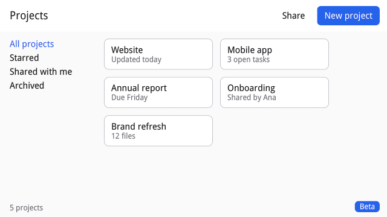
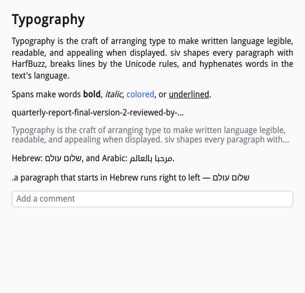

# Layout and text

## How layout works

siv's layout is one pass of constraints down and sizes up (D26). A parent
tells each child the smallest and largest size it may take; the child
picks a size and the parent places it. Containers size to their content
within their constraints, and stretch children that have no size of their
own. There are no margins: space things with a container's `gap` and its
children's `padding`. Borders draw over the padding and never move
anything.

Every horizontal property is logical: `start` and `end`, not left and
right. In a right-to-left layout (Arabic or Hebrew, or a window or node
with `SIV_DIRECTION_RTL`) rows, padding, alignment, and corners mirror
without code of yours.

[examples/layout.c](examples/layout.c) builds a typical application
window:



## Containers

**Flex** lays children along an axis (`SIV_AXIS_ROW`, in reading order, or
`SIV_AXIS_COLUMN`) with a `gap`, `justify` for free space on the main axis,
and `align_items` across it. Children take a share of free space with
`grow`, give up overflow by `shrink` weighted by their size, and start from
`basis`. The header bar is a row whose title grows to push the buttons to
the end:

```c
/* The header: a title that grows to push the buttons to the end edge. */
static void header(siv_txn txn, siv_node parent) {
	siv_node bar = siv_flex(txn, parent, SIV_DESC(siv_flex_desc, .gap = 8, .align_items = SIV_ALIGN_CENTER));
	siv_set_layout(txn, bar, SIV_DESC(siv_layout_desc, .padding = {16, 12, 10, 10}));
	siv_set_visual(txn, bar, SIV_DESC(siv_visual_desc, .background_token = SIV_COLOR_TOKEN_CARD_BG));
	siv_node title = label(txn, bar, "Projects", SIV_SIZE_ROLE_HEADING, SIV_COLOR_TOKEN_CARD_FG);
	siv_set_layout(txn, title, SIV_DESC(siv_layout_desc, .grow = 1));
	siv_set_semantics(txn, title, SIV_DESC(siv_semantics_desc, .role = SIV_ROLE_HEADING, .level = 1));
	siv_push_button(txn, bar, SIV_DESC(siv_button_desc, .label = SIV_STR("Share"), .style = SIV_BUTTON_STYLE_FLAT));
	siv_push_button(txn, bar, SIV_DESC(siv_button_desc, .label = SIV_STR("New project"), .style = SIV_BUTTON_STYLE_PRIMARY));
}
```

**Box** is block flow: children stacked top to bottom, stretched to its
width. A card is a box with a background, a border, and padding:

```c
/* A card: a box with a background, a border, rounded corners, and
 * padding. Boxes stack their children and stretch them to their width. */
static void card(siv_txn txn, siv_node parent, const char *title, const char *detail) {
	siv_node box = siv_box(txn, parent);
	siv_set_layout(txn, box, SIV_DESC(siv_layout_desc, .width = {SIV_UNIT_PX, 180}, .padding = {12, 12, 10, 10}));
	siv_set_visual(txn, box, SIV_DESC(siv_visual_desc, .background_token = SIV_COLOR_TOKEN_VIEW_BG, .border_token = SIV_COLOR_TOKEN_BORDER, .border_width = 1, .radius = {8, 8, 8, 8}));
	siv_set_semantics(txn, box, SIV_DESC(siv_semantics_desc, .role = SIV_ROLE_GROUP));
	label(txn, box, title, SIV_SIZE_ROLE_BODY, SIV_COLOR_TOKEN_VIEW_FG);
	label(txn, box, detail, SIV_SIZE_ROLE_CAPTION, SIV_COLOR_TOKEN_MUTED_FG);
}
```

**Grid** places children in column and row tracks: `SIV_TRACK_UNIT_PX`
for a fixed size, `SIV_TRACK_UNIT_FR` for a share of what is left, and
`SIV_TRACK_UNIT_AUTO` for the largest content. Children fill cells in
reading order unless their layout names a `column` and `row` (counted from
1, so 0 means automatic) with spans. The body is a fixed sidebar beside
content that takes the rest; `grow` with a zero `basis` makes the grid
take the column's leftover height:

```c
/* Two columns: 160 logical pixels, then the rest (1 fr). The grid
 * grows to fill the column's height. */
siv_track columns[] = {{SIV_TRACK_UNIT_PX, 160}, {SIV_TRACK_UNIT_FR, 1}};
siv_node body = siv_grid(txn, page, SIV_DESC(siv_grid_desc, .columns = columns, .columns_count = 2));
siv_set_layout(txn, body, SIV_DESC(siv_layout_desc, .grow = 1, .basis = {SIV_UNIT_PX, 0}));
```

**Scroll** lays out its children like a box in unlimited space, and
scrolls them on the compositor thread, so scrolling stays smooth while your
thread works (D8). Inside it, a flex row with `SIV_FLEX_WRAP` puts cards on
as many lines as fit:

```c
/* The content scrolls vertically; inside, cards wrap onto as many
 * lines as the width allows. */
siv_node scroll = siv_scroll(txn, body, SIV_SCROLL_AXIS_VERTICAL);
siv_node cards = siv_flex(txn, scroll, SIV_DESC(siv_flex_desc, .gap = 12, .flags = SIV_FLEX_WRAP));
siv_set_layout(txn, cards, SIV_DESC(siv_layout_desc, .padding = {12, 16, 12, 16}));
```

**Stack** puts children on top of each other, aligned (`align_x`,
`align_y`) or placed with insets from its edges. The window's root is a
stack that stretches its children, which is how one column fills the
window (the window's root stretches every child that does not align
itself). The badge is a second child of the root, pinned to the bottom end
corner; it aligns to the end so the stretch does not apply to it:

```c
/* A badge pinned near the window's bottom end corner, over the rest:
 * a second child of the root stack, placed with insets. The root
 * stretches its children, so the badge aligns to the end to keep its
 * own size. */
siv_node badge = label(txn, root, "Beta", SIV_SIZE_ROLE_CAPTION, SIV_COLOR_TOKEN_ACCENT_FG);
siv_set_layout(txn, badge, SIV_DESC(siv_layout_desc, .padding = {8, 8, 2, 2}, .align_x = SIV_ALIGN_END, .align_y = SIV_ALIGN_END, .inset_end = 12, .inset_bottom = 8, .flags = SIV_LAYOUT_INSET_END | SIV_LAYOUT_INSET_BOTTOM));
siv_set_visual(txn, badge, SIV_DESC(siv_visual_desc, .background_token = SIV_COLOR_TOKEN_ACCENT, .radius = {6, 6, 6, 6}));
```

## Sizes

A node's `siv_layout_desc` gives its preferred `width` and `height` as a
`siv_dimension`: auto (from content, the default), `SIV_UNIT_PX`, or
`SIV_UNIT_FRACTION` of the space its parent offers (1 is all of it). It
also has `min_width`, `max_width`, `min_height`, and `max_height`,
`padding`, the flex and grid fields, alignment in the parent, and a
`direction`.

One thing surprises people coming from CSS: a fraction resolves only
against definite space. A child of a column that sizes to its content has
nothing to take a fraction of, so the fraction counts as auto. Give the
container a size (or let its parent stretch it) first.

A stretched child stretches up to its own `max_width` or `max_height` and
no further, keeping to the start of the space; give it an alignment of its
own to place it elsewhere.

`siv_set_layout` replaces a node's whole layout. Widgets give their own
padding and least sizes as a default layout (`siv_set_default_layout`), so
setting a widget's width does not undo them (see
[Custom widgets](06-custom-widgets.md)).

## Appearance

`siv_set_visual` sets a background, a border, corner radii, and flags:
`SIV_VISUAL_CLIP` clips descendants, and an image's or canvas's own
content, to the rounded box, `SIV_VISUAL_HIDDEN`
takes a node out of layout, painting, focus, and the accessibility tree
while keeping its state, `SIV_VISUAL_NO_HIT_TEST` lets the pointer through,
and `SIV_VISUAL_LAYER` gives the node a compositor layer of its own. Prefer
the themed `background_token` and `border_token` to literal colors, so the
node follows light, dark, and high-contrast themes (see
[Theming](04-widgets-and-theming.md#theming)).

Opacity and transforms have setters of their own (`siv_set_opacity`,
`siv_set_transform`) because zero is a meaningful value for them. Moving,
fading, or transforming a node changes only its layer, without repainting.
`siv_set_transition` makes later changes of a node's opacity and transform
animate on the compositor, and `siv_set_animation` runs a repeating
animation there, such as a spinner, at no cost to your thread. Both turn
into jumps when the user asks for reduced motion.

## Text

A text node holds a run of paragraphs in one style; `siv_set_text_style`
sets it. [examples/text.lua](examples/text.lua) shows the main features:



Styles have a `family` (a name or a generic family such as `monospace`;
empty is the application's default font), a size, a weight and slant, a
color, alignment, and flags. Prefer `size_role` (body, caption, heading,
title) to a fixed `font_size` and `color_token` to a literal color: both
follow the desktop's font size and theme live.

A paragraph can be justified and hyphenated in its language. siv ships
hyphenation patterns for English, German, French, Spanish, Dutch,
Portuguese, Polish, Ukrainian, and Slovak, and takes others with
`siv_app_add_hyphenation`:

```lua
-- One paragraph, justified and hyphenated in its language.
text(story, { language = "en", align = "justify", flags = "hyphenate", line_spacing = 1.2 })
```

Spans restyle ranges of a node's text (weight, slant, size, family, color,
underline, strikethrough), given as byte offsets from `start` to `end`.
In Lua, where `end` is a keyword, the end is `stop` (`["end"]` works
too):

```lua
-- A styled range over the first occurrence of `word` in `text`.
local function span(text, word, style)
	local first, last = text:find(word, 1, true)
	style.start, style.stop = first - 1, last
	return style
end
```

```lua
-- Spans restyle ranges of a text node's text.
local mixed = "Spans make words bold, italic, colored, or underlined."
local node = text(mixed, {})
txn:set_text_spans(node, { spans = {
	span(mixed, "bold", { flags = "weight", weight = "bold" }),
	span(mixed, "italic", { flags = "slant", slant = "italic" }),
	span(mixed, "colored", { flags = "color", color_token = "accent" }),
	span(mixed, "underlined", { flags = "underline" }),
} })
```

Truncation cuts text that does not fit: `SIV_TEXT_NO_WRAP` with
`SIV_TEXT_ELLIPSIZE` cuts one line at the node's width, and `max_lines`
cuts after a number of lines. The node's text, and the name a screen
reader reads, stay whole:

```lua
-- Truncation: one line cut with an ellipsis, and two lines at most.
text("quarterly-report-final-version-2-reviewed-by-everyone.pdf",
	{ flags = { "no_wrap", "ellipsize" } }, { layout = { max_width = 300 } })
text(story, { max_lines = 2, flags = "ellipsize", color_token = "muted_fg" })
```

Each paragraph's base direction comes from its first strong character, so
a paragraph that starts in Hebrew runs right to left even in an English
window, while alignment follows the node's direction. A label with no
strong characters, such as a date or a path in a right-to-left window,
reads in order with `direction = SIV_TEXT_DIRECTION_LTR`.

Paragraph styles (alignment, indents, line and paragraph spacing, tab
width) are defaults in the text style, and per paragraph with
`siv_set_paragraph_spans`. Tab stops, start, center, end, or decimal, are
`tab_stops` in the style.

### Fonts

siv finds fonts with Fontconfig and falls back per character to fonts that
have it, so mixed scripts and emoji work without setup. Fonts of your own
go in with `siv_app_add_font` (the bytes of a TrueType or OpenType file or
collection) under a family name; siv picks faces by weight, slant, and
width as CSS does, sets variable axes, and synthesizes bold and italic
where a family lacks them. `siv_app_set_default_font` changes the default
family, which otherwise follows the desktop's.

To size things by their text, `siv_app_measure_text` lays out a string as
a canvas would draw it and returns its width, height, and baseline.

### Editors

An editor (`siv_editor`, or the framed `siv_text_field` widget) is
editable text with a caret, selection, undo and redo, input methods,
compose sequences, the clipboard, and drag and drop of text, all built in
(D15). Flags make it multiline or masked for passwords; masked text lives
in locked memory excluded from core dumps and is hidden from screen
readers. `siv_set_placeholder` shows a hint while it is empty:

```lua
-- An editor, with a placeholder shown while it is empty.
txn:editor(column, nil, {
	layout = { padding = { 8, 8, 6, 6 } },
	visual = { background_token = "view_bg", border_token = "border", border_width = 1, radius = 6 },
	semantics = { label = "Comment" },
	placeholder = "Add a comment",
	text_style = { color_token = "view_fg" },
})
```

An editor reports each change the user makes with `SIV_EVENT_TYPE_CHANGE`,
whose `text`, `caret`, and `anchor` hold the new state. Setting its text
from the application (`siv_set_text`) reports nothing and drops the undo
history, which belonged to the old text. `siv_node_get_text` and
`siv_node_get_selection` read it back at any time.

A text field with `SIV_TEXT_FIELD_STYLED` is a rich-text editor: Ctrl+B,
Ctrl+I, and Ctrl+U toggle bold, italic, and underline as undoable steps,
and the result is the editor's spans, which `siv_node_get_text_run` walks.
Your own formatting commands go through `siv_editor_format`, so they undo
like typing.
