# Stock widgets and theming

## The widgets

siv's stock widgets are built from the same nodes and public functions you
use (D22), so each is a function that appends a widget in a transaction and
returns its root node:

| Kind | Builders |
| --- | --- |
| Buttons | `siv_push_button`, `siv_toggle_button`, `siv_menu_button` |
| Choices | `siv_check_box`, `siv_switch`, `siv_radio_group` with `siv_radio`, `siv_combo_box` with `siv_combo_box_item` |
| Text | `siv_text_field` (single line, multiline, masked, or styled) |
| Ranges | `siv_slider`, `siv_spin_button`, `siv_progress_bar` |
| Menus | `siv_menu`, `siv_menu_item`, `siv_menu_open`, `siv_menu_open_at` |
| Overlays | `siv_dialog`, `siv_toast`, `siv_popover_create` |
| Structure | `siv_tabs` with `siv_tab`, `siv_split_pane` |
| Views | `siv_list_view`, `siv_tree_view`, `siv_table_view`, `siv_grid_view` (see [Lists, tables, and trees](08-lists-and-tables.md)) |

Every widget is focusable with the right role, takes its accessible name
from its label, follows WAI-ARIA keyboard practice (arrow keys swap in
right-to-left layouts), and draws in the theme's colors.
[examples/settings.zig](examples/settings.zig) is a form of them, in Zig:

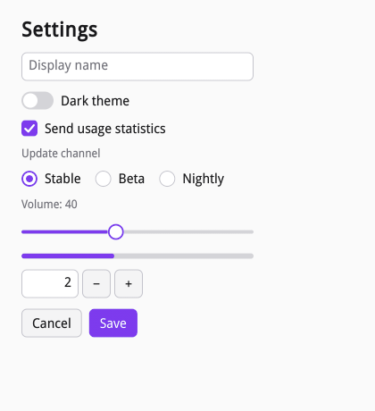

Items that hold several options are built item by item, so each option is
a node too:

```zig
// Choices are built item by item; the group's value is the index.
const channel_label = "Update channel";
_ = try caption(txn, column, channel_label);
const channel = siv.radioGroup(txn, column, .{ .label = channel_label });
for ([_][]const u8{ "Stable", "Beta", "Nightly" }) |option| {
    _ = siv.radio(txn, channel, .{ .label = option });
}
```

## Driving widgets

A few functions drive every widget, instead of setters per kind:
`siv_widget_set_value` and `siv_widget_get_value`, `siv_widget_set_label`,
`siv_widget_set_disabled`, `siv_widget_set_range`, and
`siv_widget_set_icon`. A widget's value is one number: 0 or 1 for toggles
(0.5 is a check box's mixed state), the chosen index for choices, the
number itself for ranges. They are transaction operations, so a value
lands in the same frame as the tree changes around it. They work through a
widget interface on the widget's root, which widgets of your own set too
(`siv_set_widget`, see [Custom widgets](06-custom-widgets.md)), so one
call drives any widget.

Widgets report what the user did through `siv_on` handlers on the node
the builder returned: `SIV_EVENT_TYPE_ACTIVATE` for buttons,
`SIV_EVENT_TYPE_CHANGE` with `value` (and `index` for choices) when the
value changed, `SIV_EVENT_TYPE_SELECT` for menus and views, and
`SIV_EVENT_TYPE_CLOSE` for overlays. Setting a value from the application
reports nothing, so a handler can mirror one widget in another without
loops:

```zig
/// A slider reports its new value; setting another widget's value from the
/// application reports nothing.
fn onVolume(form: *Form, event: *const siv.Event) !void {
    var buf: [32]u8 = undefined;
    const label = try std.fmt.bufPrint(&buf, "Volume: {d:.0}", .{event.value});
    const txn = try siv.txnBegin(event.window);
    errdefer siv.txnAbort(txn);
    siv.setText(txn, form.volume_label, label);
    siv.widgetSetValue(txn, form.level, event.value);
    try siv.txnCommit(txn);
}
```

The sample's handlers are Zig functions turned into C callbacks by a small
adapter, since every callback siv calls is a C function:

```zig
fn handler(comptime f: fn (*Form, *const siv.Event) anyerror!void) siv.EventFn {
    return struct {
        fn call(user_data: ?*anyopaque, _: siv.Node, event: *const siv.Event) callconv(.c) siv.EventResult {
            f(@ptrCast(@alignCast(user_data)), event) catch return .pass;
            return .handled;
        }
    }.call;
}
```

A widget's behavior lives in its default handlers (`siv_on_default`),
which run only when your `siv_on` handler for the event is missing or
passes. So `siv_on` is always yours, and returning handled from it
overrides the widget: a dialog's close handler that returns true keeps the
dialog open.

## Menus, popovers, and dialogs

[examples/menus.c](examples/menus.c) shows the overlays.

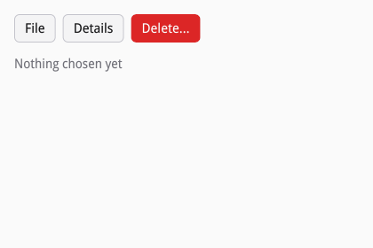

A menu is a model in the tree: a node that takes no space, with a hidden
child per item, which you relabel, disable, check, and remove like any
node. `siv_menu_button` holds one and opens it below itself; `siv_menu_open`
and `siv_menu_open_at` open any menu, the latter at a point for context
menus. Choosing reports `SIV_EVENT_TYPE_SELECT` with the item's index
(separators count). An item with a `submenu` opens it beside itself:

```c
/* A menu button holds its items; a submenu is a menu of its own,
 * placed anywhere in the tree (it takes no space). */
siv_node file = siv_menu_button(txn, toolbar, SIV_DESC(siv_button_desc, .label = SIV_STR("File")));
siv_node sort = siv_menu(txn, toolbar, SIV_DESC(siv_menu_desc, .label = SIV_STR("Sort by")));
siv_menu_item(txn, sort, SIV_DESC(siv_menu_item_desc, .label = SIV_STR("Name")));
siv_menu_item(txn, sort, SIV_DESC(siv_menu_item_desc, .label = SIV_STR("Date")));
siv_on(txn, sort, SIV_EVENT_TYPE_SELECT, on_sort, NULL, s);
siv_menu_item(txn, file, SIV_DESC(siv_menu_item_desc, .label = SIV_STR("New"), .shortcut = SIV_STR("Ctrl+N"), .icon = SIV_STR("document-new")));
siv_menu_item(txn, file, SIV_DESC(siv_menu_item_desc, .label = SIV_STR("Open…"), .shortcut = SIV_STR("Ctrl+O"), .mnemonic = 'o'));
siv_menu_item(txn, file, SIV_DESC(siv_menu_item_desc, .flags = SIV_MENU_ITEM_SEPARATOR));
siv_menu_item(txn, file, SIV_DESC(siv_menu_item_desc, .label = SIV_STR("Show hidden files"), .flags = SIV_MENU_ITEM_CHECKABLE));
siv_menu_item(txn, file, SIV_DESC(siv_menu_item_desc, .label = SIV_STR("Sort by"), .submenu = sort));
siv_on(txn, file, SIV_EVENT_TYPE_SELECT, on_file, NULL, s);
```

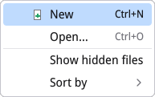

Menus and popovers are popups, windows of their own placed against an
anchor by the compositor (D17). A popup takes the keyboard with the input
that opened it, so open one while handling that click or key. A popover is
a popup with a themed card whose content you build in a transaction on the
popup window:

```c
/* A popover is a popup window with a themed card: build its content in a
 * transaction on the popup, then show it while handling the click. */
static siv_event_result on_info(void *user_data, siv_node button, const siv_event *event) {
	(void)user_data;
	(void)event;
	siv_window popup;
	siv_node content;
	if (siv_popover_create(button, SIV_DESC(siv_popover_desc, .label = SIV_STR("Details")), &popup, &content) != SIV_OK) return SIV_EVENT_RESULT_PASS;
	siv_txn txn;
	if (siv_txn_begin(popup, &txn) != SIV_OK) return SIV_EVENT_RESULT_PASS;
	siv_node text = siv_text(txn, content, SIV_STR("Last saved 2 minutes ago"));
	siv_set_text_style(txn, text, SIV_DESC(siv_text_style_desc, .color_token = SIV_COLOR_TOKEN_CARD_FG));
	siv_check_box(txn, content, SIV_DESC(siv_toggle_desc, .label = SIV_STR("Save automatically"), .checked = SIV_TOGGLE_ON));
	siv_result r = siv_txn_commit(txn);
	if (r == SIV_OK) r = siv_popup_show(popup);
	if (r != SIV_OK) fprintf(stderr, "menus: %s\n", siv_result_name(r));
	return SIV_EVENT_RESULT_HANDLED;
}
```

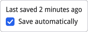

Dialogs and toasts are overlays in the window's own tree. A dialog is a
modal child of a stack (usually the window's root): it holds focus and
pointer input until it goes, then focus returns where it was. Its title,
text, and two parts, the content and the actions row, are reached with
`siv_widget_get_part`:

```c
/* A dialog is an overlay in the window's own tree: a child of the root
 * stack, modal while it exists. */
static siv_event_result on_delete(void *user_data, siv_node button, const siv_event *event) {
	(void)button;
	struct app_state *s = user_data;
	siv_txn txn;
	if (s->dialog || siv_txn_begin(event->window, &txn) != SIV_OK) return SIV_EVENT_RESULT_PASS;
	s->dialog = siv_dialog(txn, s->root, SIV_DESC(siv_dialog_desc, .title = SIV_STR("Delete “Draft”?"), .text = SIV_STR("It will be gone for good.")));
	siv_node actions = siv_widget_get_part(s->dialog, SIV_WIDGET_PART_ACTIONS, 0);
	siv_node cancel = siv_push_button(txn, actions, SIV_DESC(siv_button_desc, .label = SIV_STR("Cancel")));
	siv_node confirm = siv_push_button(txn, actions, SIV_DESC(siv_button_desc, .label = SIV_STR("Delete"), .style = SIV_BUTTON_STYLE_DESTRUCTIVE));
	siv_on(txn, cancel, SIV_EVENT_TYPE_ACTIVATE, on_cancel, NULL, s);
	siv_on(txn, confirm, SIV_EVENT_TYPE_ACTIVATE, on_confirm, NULL, s);
	siv_on(txn, s->dialog, SIV_EVENT_TYPE_CLOSE, on_dialog_close, NULL, s);
	if (siv_txn_commit(txn) != SIV_OK) s->dialog = 0;
	return SIV_EVENT_RESULT_HANDLED;
}
```

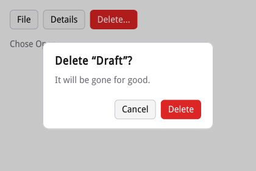

Escape and a click on the scrim report `SIV_EVENT_TYPE_CLOSE`; unless your
handler returns true, the dialog removes itself. A toast is a message at
the bottom of a stack that screen readers announce and that times out:

```zig
fn onSave(form: *Form, event: *const siv.Event) !void {
    const message = "Settings saved";
    const txn = try siv.txnBegin(event.window);
    errdefer siv.txnAbort(txn);
    _ = siv.toast(txn, form.root, .{ .text = message });
    try siv.txnCommit(txn);
}
```

Tabs show one panel at a time (`siv_tab` returns the panel to fill), and a
split pane has start and end panes and a divider the user drags; both
expose their parts through `siv_widget_get_part`.

## Tooltips and combo boxes

[examples/export.c](examples/export.c) has a toolbar of icon-only buttons
and a combo box that picks an export format.

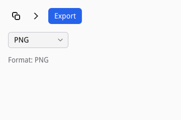

A tooltip is a small popup that explains a node. Any node can have one
with `siv_set_tooltip`, and an icon-only button shows its label as its
tooltip without asking, since its icon is all a sighted user sees. siv
shows a tooltip half a second after the pointer rests on the node or
keyboard focus reaches it, and hides it on a click, a key, or scrolling.
Its text is also the node's accessible description, so screen reader
users hear it too:

```c
/* An icon-only button's label names it for screen readers and shows
 * in its tooltip; any node can have a tooltip of its own. */
siv_node toolbar = siv_flex(txn, column, SIV_DESC(siv_flex_desc, .gap = 8));
siv_set_semantics(txn, toolbar, SIV_DESC(siv_semantics_desc, .role = SIV_ROLE_TOOLBAR, .label = SIV_STR("Export")));
siv_push_button(txn, toolbar, SIV_DESC(siv_button_desc, .label = SIV_STR("Copy"), .icon = SIV_STR("edit-copy-symbolic"), .style = SIV_BUTTON_STYLE_FLAT, .flags = SIV_WIDGET_ICON_ONLY));
siv_push_button(txn, toolbar, SIV_DESC(siv_button_desc, .label = SIV_STR("Next page"), .icon = SIV_STR("go-next-symbolic"), .style = SIV_BUTTON_STYLE_FLAT, .flags = SIV_WIDGET_ICON_ONLY));
siv_node save = siv_push_button(txn, toolbar, SIV_DESC(siv_button_desc, .label = SIV_STR("Export"), .style = SIV_BUTTON_STYLE_PRIMARY));
siv_set_tooltip(txn, save, SIV_STR("Saves a copy in the chosen format"));
```

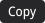
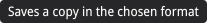

A combo box shows the selected option and opens the list of options
below itself. Like a radio group, its options are added one by one, its
value is the selected index (`siv_widget_set_value` and
`siv_widget_get_value`), and choosing reports `SIV_EVENT_TYPE_CHANGE` with
`index`:

```c
/* A combo box's options are nodes added one by one; its value is the
 * selected option's index. */
siv_node format = siv_combo_box(txn, column, SIV_DESC(siv_combo_box_desc, .label = SIV_STR("Format")));
siv_combo_box_item(txn, format, SIV_DESC(siv_combo_box_item_desc, .label = SIV_STR("PNG")));
siv_combo_box_item(txn, format, SIV_DESC(siv_combo_box_item_desc, .label = SIV_STR("JPEG")));
siv_combo_box_item(txn, format, SIV_DESC(siv_combo_box_item_desc, .label = SIV_STR("WebP")));
siv_combo_box_item(txn, format, SIV_DESC(siv_combo_box_item_desc, .label = SIV_STR("AVIF"), .flags = SIV_WIDGET_DISABLED));
siv_on(txn, format, SIV_EVENT_TYPE_CHANGE, on_format, NULL, s);
```

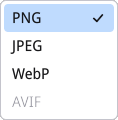

When the list is closed, the arrow keys select an option at once, skipping
disabled ones. Space, Enter, a click, or Alt+Down open the list, where the
arrows move the focus and Enter or a click chooses. Typing the first
letters of an option finds it, open or closed. Because options are nodes,
you relabel, disable, and remove them like any node, and
`siv_widget_get_part` with `SIV_WIDGET_PART_ITEM` finds one by index.

## Theming

Colors in siv are themed values that nodes refer to and siv resolves when
it paints (D29). There are four compiled variants of the theme (light,
dark, and high contrast of each), picked by the desktop's color scheme and
contrast through the settings portal, and the desktop's accent color
replaces the theme's. When the desktop changes, every window repaints in
the new colors; your tree does not change.

Refer to themed colors with tokens: `background_token`, `border_token`,
and shadows' `color_token` in visuals, `color_token` in text styles, spans, and icons. The tokens
cover window, view, and card surfaces and their text, muted and disabled
text, borders and separators, controls at rest, hovered, and pressed, the
accent and the text on it, selections, focus rings, tracks and knobs,
destructive actions, the modal scrim, inverse surfaces for toasts, the
success and warning colors of icons, and sidebar and secondary sidebar
panes recessed from the view (navigation lists, a column browser's outer
columns), and the color of shadows under raised surfaces. Text sizes follow the desktop's font
size through `size_role`.

An application can choose for the user: `siv_app_set_theme` fixes the
scheme or contrast, and `siv_app_set_theme_color` overrides a token in one
variant or all of them. Overriding the accent moves what derives from it,
its hover and pressed shades, the text on it, focus rings, and selections:

```zig
// The application's own accent, in every variant of the theme. Hover
// and pressed shades, focus rings, and selections follow it.
try siv.appSetThemeColor(app, .all, .accent, .{ .r = 0.49, .g = 0.23, .b = 0.93, .a = 1 });
```

```zig
/// The switch's value is 0 or 1. The theme follows the desktop unless the
/// application chooses; choosing repaints every window.
fn onDarkTheme(form: *Form, event: *const siv.Event) !void {
    try siv.appSetTheme(form.app, .{ .scheme = if (event.value != 0) .dark else .follow });
}
```

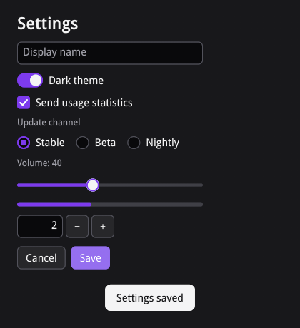

### The user's theme

Users theme every siv application at once, live, between the desktop's
settings and your overrides: the compiled tokens, then the desktop's
accent, then the user's theme, then `siv_app_set_theme_color`. Keep
overrides rare, or your application stops following the user. siv reads
the theme on a worker before the first frame and repaints every window
when it changes.

- `~/.config/siv/theme.toml` (under `$XDG_CONFIG_HOME`) sets tokens by
  name, for both schemes or in a `[light]` or `[dark]` table. A token
  that is missing or does not parse keeps siv's color. Tools such as
  matugen or pywal can write it from a template.
- Omarchy's current theme, when there is no theme.toml, or under one that
  says `base = "omarchy"`. siv maps its `colors.toml` to the tokens:
  `background` to the view, the darker backgrounds to the window and the
  sidebars, `lighter_background` to controls, `muted` to borders,
  `selection` to selected rows, and the accent and the named colors to
  the accent, destructive, success, and warning tokens. Its `mode`
  decides light or dark.
- In high contrast siv uses its own high-contrast colors instead.
  `SIV_THEME=none` turns user themes off. `SIV_THEME=FILE` reads a
  theme.toml or an Omarchy colors.toml from elsewhere, also on the
  headless backend, which otherwise ignores the user's files so that
  tests do not depend on them.

```toml
# For both schemes; the accent's hover and pressed shades, the text on
# it, and focus rings follow it.
accent = "#d19a66"

[light]
window_bg = "#ece8e1"
view_bg = "#faf8f4"
view_fg = "#3a3530"
control_bg = "#e4dfd6"
```

Under the dark half of that file, the settings form keeps its purple
accent, since the application's override wins:

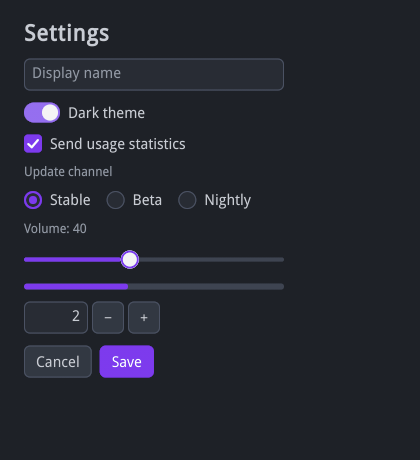

Canvases read resolved colors with `siv_window_get_color` and are drawn
again when the theme changes (see [Custom widgets](06-custom-widgets.md)).
Spacing, radii, and control heights are compiled into the widgets.

Colors you copy out of siv, into a web page's CSS variables or a
terminal's palette, need reading again when the theme changes. Windows
get `SIV_WINDOW_EVENT_TYPE_THEME_CHANGED` in their `on_event` when a
color `siv_window_get_color` returns changed: the desktop's scheme,
contrast, or accent, the user's theme, or your own `siv_app_set_theme`
and `siv_app_set_theme_color` calls. It arrives at the next dispatch,
once for a burst of changes, and not at all when a change leaves the
window's colors as they were, such as a theme for the variant it does
not show. Read the colors when the window is created and again on each
event.

Motion follows the desktop too: with reduced motion (the desktop's
setting, or `SIV_APP_REDUCED_MOTION`), transitions jump, animations stop,
and carets stop blinking.

### Themes for part of a window

A node can carry a theme for its subtree: `siv_set_theme` chooses its
scheme (`dark` for a sidebar that stays dark, `inverse` for the scheme
opposite the window's, `follow` for the desktop's even where you fixed
the window's) and high contrast, and `siv_set_theme_color` overrides
tokens in it, over your application-wide overrides. Everything inside
resolves its themed colors against it, stock widgets included, and so do
menus, popovers, and tooltips opened from inside it. siv keeps your
choices, not colors, so the subtree still follows the desktop's accent,
the user's theme for its scheme, and high contrast, which a subtree can
turn on but never off. Text sizes stay the window's.
[examples/sidebar.lua](examples/sidebar.lua) has a dark sidebar, a banner
in the opposite scheme, and a section with its own accent:

```lua
-- Dark whatever the desktop's scheme: every themed color in the
-- sidebar resolves in the dark variant of the theme.
local sidebar = txn:flex(row, { axis = "column", gap = 8 }, {
	theme = { scheme = "dark" },
	layout = { width = 170, padding = { 8, 8, 12, 12 } },
	visual = { background_token = "sidebar_bg" },
})
```

```lua
-- An accent for one section: what derives from it (hover and pressed
-- shades, focus rings, selections) follows, in every variant.
local section = txn:flex(main, { gap = 12, align_items = "center" })
txn:set_theme_color(section, "all", "accent", { r = 0.05, g = 0.58, b = 0.53, a = 1 })
```

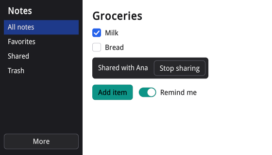

The menu the sidebar's More button opens is dark too. In a dark window
the sidebar stays as it was and the banner turns light:

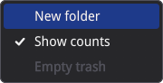

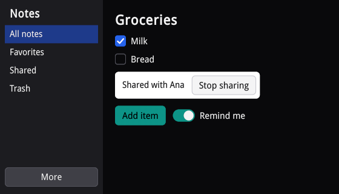

Canvases inside a themed subtree read its colors with
`siv_node_get_color` on their own node; `siv_window_get_color` answers for
the window.
