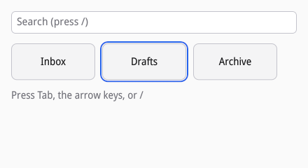
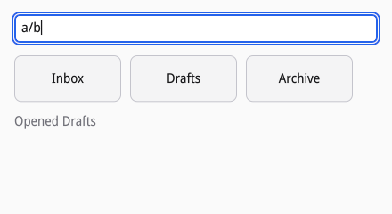
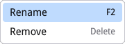

# Events and focus

## Handlers

A node has at most one handler per event type, set with `siv_on` in a
transaction. Handlers run at safe points on your thread with the node they
were set on and a `siv_event`:

| Event | When | Delivered |
| --- | --- | --- |
| `SIV_EVENT_TYPE_POINTER` | Motion, buttons, enter, leave, cancel | From the node under the pointer up to the root |
| `SIV_EVENT_TYPE_KEY` | A key pressed, repeated, or released | From the focused node up to the root |
| `SIV_EVENT_TYPE_SCROLL` | Wheel and touchpad scrolling | From the node under the pointer up to the root |
| `SIV_EVENT_TYPE_ACTIVATE` | A click, or Enter or Space while focused | The node |
| `SIV_EVENT_TYPE_FOCUS` | Focus gained or lost | The node |
| `SIV_EVENT_TYPE_CHANGE` | The user changed an editor's text or a widget's value | The node |
| `SIV_EVENT_TYPE_SELECT`, `_SORT`, `_CLOSE` | Widgets: a choice, a sort, a close request | The node |
| `SIV_EVENT_TYPE_DROP`, `_DRAG` | Drag and drop (see [Clipboard and drag and drop](10-clipboard-and-dnd.md)) | The node |
| `SIV_EVENT_TYPE_SET_VALUE` | Assistive technology sets a value | The node |
| `SIV_EVENT_TYPE_VIEWPORT` | A scroll node's visible region changed | The scroll node |

Pointer, key, and scroll events bubble: each node from the target up to
the root gets a turn until a handler stops them. `event->target` names the
node the event started at, so a handler on a container can tell its own
events from a child's.

A handler returns a `siv_event_result`, which makes two separate requests,
as the DOM's `stopPropagation` and `preventDefault` do:

| Result | Bubbling | Default action |
| --- | --- | --- |
| `SIV_EVENT_RESULT_PASS` | continues | runs |
| `SIV_EVENT_RESULT_HANDLED` | stops | skipped |
| `SIV_EVENT_RESULT_STOP` | stops | runs |
| `SIV_EVENT_RESULT_PREVENT` | continues, with `SIV_EVENT_PREVENTED` set | skipped |

Default actions are siv's own behavior and widgets' (their
`siv_on_default` handlers): a primary press focuses the nearest focusable
node, a release over the pressed node activates it, Tab and Shift+Tab move
focus, Enter and Space activate, an editor types a key, and arrow and page
keys scroll the nearest scroll node. In C, returning `true` still means
handled. In Lua, return `true`, or `"stop"` or `"prevent"`.

[examples/events.c](examples/events.c) puts this to work: shortcuts on the
window, tiles that move focus with the arrow keys, hover feedback, and a
context menu.



## Keys

A key event has a `keysym`, the `text` it typed (if any), the `modifiers`
held, and flags: `SIV_EVENT_PRESSED` for a press or repeat,
`SIV_EVENT_REPEAT` for a repeat. Keysyms are XKB's: siv.h names the keys
applications bind (`SIV_KEY_ESCAPE`, `SIV_KEY_F2`, `SIV_KEY_PAGE_DOWN`), and
character keys are their code point (`'/'`), so compare with either.

Window-wide shortcuts go on the root, which every key bubbles to. Here "/"
focuses the search field from anywhere and Escape leaves it:

```c
/* Keys start at the focused node and bubble up to the root. "/" anywhere
 * focuses the search field; Escape leaves it. */
static siv_event_result on_root_key(void *user_data, siv_node root, const siv_event *event) {
	(void)root;
	struct ui *ui = user_data;
	if (!(event->flags & SIV_EVENT_PRESSED)) return SIV_EVENT_RESULT_PASS;
	if (event->keysym == '/') {
		focus(ui->search);
		return SIV_EVENT_RESULT_HANDLED;
	}
	if (event->keysym == SIV_KEY_ESCAPE) {
		focus(related(ui->tiles, SIV_RELATION_FIRST_CHILD));
		return SIV_EVENT_RESULT_HANDLED;
	}
	return SIV_EVENT_RESULT_PASS;
}
```

Without more, typing "/" into the search field would trigger the shortcut
too, since the key bubbles from the field. The field stops its keys, so
they reach no ancestor; stopping does not prevent the default action, so
the field still types them:

```c
/* Keys typed into the search field stop there, so "/" types a slash
 * instead of reaching the shortcut above; the editor still types them,
 * since stopping does not prevent the default action. Escape goes on. */
static siv_event_result on_search_key(void *user_data, siv_node search, const siv_event *event) {
	(void)user_data;
	(void)search;
	return event->keysym == SIV_KEY_ESCAPE ? SIV_EVENT_RESULT_PASS : SIV_EVENT_RESULT_STOP;
}
```



Bubbling means the focused node and its widget go first: a list row moves
its cursor on the arrow keys before the window hears them. An application
whose keys are its own, such as a vim-style editor or file manager, sets
a capture handler on the root instead, with `siv_on_capture`: keys come
down from the root to the focused node through capture handlers before
any `siv_on` handler sees them, with `SIV_EVENT_CAPTURING` set. The
results mean what they mean when bubbling. Handled ends the key there;
pass lets it go on to the focused node as usual, so an editor still types
what the keymap does not bind; stop skips every other handler but leaves
the default actions (a widget's default handler, an editor typing);
prevent goes on but stops the default actions. Only keys have a capture
phase.

## Actions and accelerators

Commands that a menu item, a toolbar button, and a key all run are
actions (`siv_action_create`): a name, a label, accelerators
(`siv_accel`, such as `'s'` with `SIV_MODIFIERS_CTRL`), an enabled state,
and for toggles and choices a value. Pass an action as a button's,
toggle's, or menu item's `action` (or bind any node with
`siv_set_action`) and the widget runs it when activated, dims while it is
disabled (`siv_action_set_enabled`), and shows its value as a check mark
or a pressed state; a menu item also shows its label and key. siv runs an
accelerator when the focused node leaves the key: an editor keeps Ctrl+A,
Ctrl+C, and its typing, a list row its arrows, and a handler that returns
prevent keeps a key from accelerators. An action without a window belongs
to the application, and the desktop can invoke it by name; one with a
window answers only that window's keys. `siv_app_get_action` lists what a
window's keys reach, for a shortcuts window or a command palette, and
assistive technology hears each bound control's key. The design is D34
in DESIGN.md.

## Focus

A node takes keyboard focus if its semantics say `SIV_SEMANTICS_FOCUSABLE`
(editors and stock widgets do by themselves). Focusability is part of
semantics on purpose: a node cannot take focus without the role and name a
screen reader needs to announce it (see [Accessibility](11-accessibility.md)):

```c
/* Focusable with a role and a name: Tab reaches it, Enter and
 * Space activate it, and a screen reader announces it. */
siv_set_semantics(txn, tile, SIV_DESC(siv_semantics_desc, .role = SIV_ROLE_BUTTON, .label = names[i], strlen(names[i]), .flags = SIV_SEMANTICS_FOCUSABLE));
siv_set_cursor(txn, tile, SIV_CURSOR_POINTER);
siv_on(txn, tile, SIV_EVENT_TYPE_POINTER, on_tile_pointer, NULL, ui);
siv_on(txn, tile, SIV_EVENT_TYPE_ACTIVATE, on_tile_activate, NULL, ui);
```

Tab and Shift+Tab move through focusable nodes in tree order, which is the
same in both directions of text. `siv_node_focus` moves focus,
`siv_window_get_focus` reads it, and focus events report gaining and
losing it (`SIV_EVENT_GAINED`). siv draws a focus ring around the focused
node when focus moved by keyboard (`SIV_EVENT_VISIBLE`), and none when it
followed a click.

Composite widgets use roving focus: one Tab stop for the whole group, and
arrow keys to move inside it. The tiles do that on their container,
mirrored right to left:

```c
/* Left and Right move focus between the tiles, swapped right to left. */
static siv_event_result on_tiles_key(void *user_data, siv_node tiles, const siv_event *event) {
	(void)user_data;
	if (!(event->flags & SIV_EVENT_PRESSED) || (event->keysym != SIV_KEY_LEFT && event->keysym != SIV_KEY_RIGHT)) return SIV_EVENT_RESULT_PASS;
	bool rtl = false;
	if (siv_node_is_rtl(tiles, &rtl) != SIV_OK) return SIV_EVENT_RESULT_PASS;
	bool forward = (event->keysym == SIV_KEY_RIGHT) != rtl;
	siv_node next = related(event->target, forward ? SIV_RELATION_NEXT : SIV_RELATION_PREVIOUS);
	if (next) focus(next);
	return SIV_EVENT_RESULT_HANDLED;
}
```

Focus moved with `siv_node_focus` shows the ring when the last input was
a key, as here, and not after a pointer press, the same rule Tab and the
stock widgets follow; the screenshot shows the ring on the tile the arrow
key reached.

Modal nodes (`SIV_SEMANTICS_MODAL`, such as dialogs) contain focus: while
one is shown, Tab cycles inside it, the pointer reaches only it, and when
it goes, focus returns to where it was.

## The pointer

A pointer event has a `phase` (down, up, move, enter, leave, cancel), the
`button`, the position `x` and `y` in the node's coordinates, the
modifiers, and for primary presses `clicks`: 2 for a double click, 3 for a
triple, within the desktop's double-click time. The node that got a press
gets the moves and the release too, even outside it, until the button is
released; `cancel` means the press was taken away (a drag started, or the
compositor claimed a touch).

Enter and leave do not bubble: every node on the path under the pointer
hears its own, and moving onto a child does not leave its parent. The
tiles light up under the pointer, and open a context menu at a secondary
click:

```c
/* Hover: pointer enter and leave arrive on the node itself. A secondary
 * press opens the context menu where it happened. */
static siv_event_result on_tile_pointer(void *user_data, siv_node tile, const siv_event *event) {
	struct ui *ui = user_data;
	if (event->phase == SIV_POINTER_PHASE_ENTER || event->phase == SIV_POINTER_PHASE_LEAVE) {
		siv_txn txn;
		if (siv_txn_begin(event->window, &txn) != SIV_OK) return SIV_EVENT_RESULT_PASS;
		bool over = event->phase == SIV_POINTER_PHASE_ENTER;
		siv_set_visual(txn, tile, SIV_DESC(siv_visual_desc, .background_token = over ? SIV_COLOR_TOKEN_CONTROL_HOVER : SIV_COLOR_TOKEN_CONTROL_BG, .border_token = SIV_COLOR_TOKEN_BORDER, .border_width = 1, .radius = {8, 8, 8, 8}));
		commit(txn);
		return SIV_EVENT_RESULT_PASS;
	}
	if (event->phase == SIV_POINTER_PHASE_DOWN && event->button == SIV_POINTER_BUTTON_SECONDARY) {
		return siv_menu_open_at(ui->menu, tile, event->x, event->y) == SIV_OK ? SIV_EVENT_RESULT_HANDLED : SIV_EVENT_RESULT_PASS;
	}
	return SIV_EVENT_RESULT_PASS;
}
```



A node's cursor shape (`siv_set_cursor`, CSS names such as
`SIV_CURSOR_POINTER`) applies to it and descendants that set none;
`siv_window_set_cursor` overrides every node, for busy states. Windows that
draw their own decorations start moves and resizes from a pointer-down
handler with `siv_window_begin_move` and `siv_window_begin_resize`.

## Scrolling

Scroll nodes scroll on the compositor thread without your code (D8).
Scroll events reach your handlers first only where a node has a scroll
handler, or while Ctrl, Alt, or Super is held, for zooming and the like.
`siv_scroll_to` moves a scroll node; the viewport event reports where it
is, for virtualized content (see [Lists, tables, and trees](08-lists-and-tables.md)).

## Timers

`siv_timer_start` runs a function once at a safe point after a delay, and
`siv_timer_cancel` cancels it; for repeating work, start the next timer
from the callback. Nothing in siv polls: an idle application sleeps until
input, a timer, or posted work wakes it.
