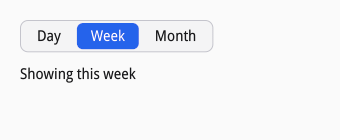
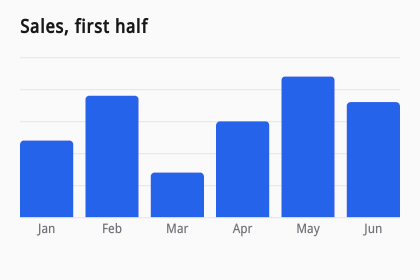
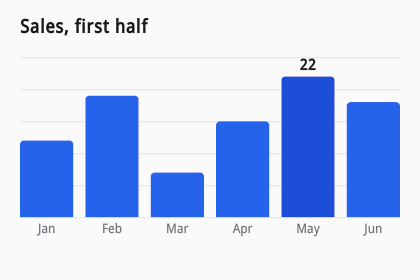

# Custom widgets

siv's stock widgets are written against the public C API and nothing else
(D22), so a widget of yours can do anything they do. There are two ways to
build one: compose nodes, as the stock widgets do, or draw it on a canvas.
Compose when the widget is made of text, boxes, and focusable parts, so it
gets layout, text, input methods, and accessibility from the nodes. Draw
when it is a picture: a chart, a dial, a waveform.

## From primitives

[examples/segmented.c](examples/segmented.c) builds a segmented control:
one of a few options, side by side.



A widget follows the stock widgets' conventions so that it composes with
them.

**A builder in a transaction.** It appends the widget under a parent in
the caller's transaction and returns its root, or 0 once the transaction
has failed. It reports bad arguments with `siv_txn_fail`, which makes the
caller's commit fail like any other operation:

```c
/* Builds the control in the caller's transaction and returns its root, or
 * 0 once the transaction has failed, like every builder. */
static siv_node segmented(siv_txn txn, siv_node parent, const char *label, const char *const *options, uint32_t count) {
	if (count == 0) {
		siv_txn_fail(txn, SIV_ERROR_INVALID_ARGUMENT);
		return 0;
	}
	siv_node root = siv_flex(txn, parent, SIV_DESC(siv_flex_desc, .gap = 2));
	struct segmented *s = NULL;
	if (siv_set_data(txn, root, &segmented_key, sizeof *s, (void **)&s) != SIV_OK) return 0;
	*s = (struct segmented){.root = root, .count = count, .selected = 0};
	/* Metrics go in the default layout, so the application's own
	 * siv_set_layout adds to them instead of replacing them. */
	siv_set_default_layout(txn, root, SIV_DESC(siv_layout_desc, .padding = {3, 3, 3, 3}));
	siv_set_visual(txn, root, SIV_DESC(siv_visual_desc, .background_token = SIV_COLOR_TOKEN_CONTROL_BG, .border_token = SIV_COLOR_TOKEN_BORDER, .border_width = 1, .radius = {8, 8, 8, 8}));
	siv_set_semantics(txn, root, SIV_DESC(siv_semantics_desc, .role = SIV_ROLE_GROUP, .label = label, strlen(label)));
	siv_on_default(txn, root, SIV_EVENT_TYPE_KEY, root_key, NULL, s);
	siv_set_widget(txn, root, SIV_DESC(siv_widget_desc, .user_data = s, .set_value = widget_set_value, .get_value = widget_get_value, .set_label = widget_set_label, .focus = widget_focus));
	for (uint32_t i = 0; i < count; i++) {
		siv_node seg = siv_box(txn, root);
		siv_set_default_layout(txn, seg, SIV_DESC(siv_layout_desc, .padding = {14, 14, 5, 5}));
		siv_on_default(txn, seg, SIV_EVENT_TYPE_ACTIVATE, segment_activate, NULL, s);
		siv_text(txn, seg, options[i], strlen(options[i]));
	}
	restyle(txn, s);
	return root;
}
```

**State in node data.** `siv_set_data` gives a node zeroed memory under a
key of yours (the address of a static variable is a unique key), freed
with the node, and `siv_node_get_data` finds it again from the handle.
Handlers and interface callbacks set with that memory as their
`user_data` need no destroy-notify:

```c
/* State lives with the widget's root node: node data under a key of the
 * widget's own, freed with the node. */
static char segmented_key;

struct segmented {
	siv_node root;
	uint32_t count;
	int32_t selected;
};
```

**Behavior in default handlers.** `siv_on_default` holds the widget's
handlers, which run only if the application's `siv_on` handler for the
event is missing or passes. The application keeps `siv_on` for itself and
overrides the widget by returning handled.

**Metrics in the default layout.** `siv_set_default_layout` holds the
widget's padding and least sizes. Fields the application's `siv_set_layout`
leaves zero take them, so placing or sizing the widget does not undo them.

**Changes reported with `siv_node_emit`.** It delivers an event to the node's
`siv_on` handler and then its default handler, as siv delivers input, so
the application hears the user's choice as `SIV_EVENT_TYPE_CHANGE` on the
widget's root, as with any stock widget:

```c
/* Selects an option as the user did: restyles, moves focus along, and
 * reports SIV_EVENT_CHANGE to the root's handlers. A screen reader
 * chooses an option by activating it, as a click does. */
static void choose(siv_window window, struct segmented *s, int32_t index) {
	if (index < 0 || (uint32_t)index >= s->count || index == s->selected) return;
	siv_txn txn;
	if (siv_txn_begin(window, &txn) != SIV_OK) return;
	s->selected = index;
	restyle(txn, s);
	if (siv_txn_commit(txn) != SIV_OK) return;
	if (siv_node_focus(segment_at(s->root, index)) != SIV_OK) return;
	siv_event change = {.size = sizeof change, .type = SIV_EVENT_TYPE_CHANGE, .value = index, .index = (uint32_t)index, .target = s->root};
	bool handled;
	if (siv_node_emit(s->root, &change, &handled) != SIV_OK) fprintf(stderr, "segmented: cannot report the change\n");
}
```

**Semantics and keyboard.** Every part says what it is: the root is a
group with the widget's name, each option a radio with its checked state,
position, and set size. Only the selected option is focusable, so the
widget is one Tab stop, and arrow keys move the selection, swapped in
right-to-left layouts:

```c
/* Restyles every segment for the selection. Only the selected segment is
 * focusable (roving focus), so the control is one Tab stop. */
static void restyle(siv_txn txn, struct segmented *s) {
	siv_node seg = segment_at(s->root, 0);
	for (int32_t i = 0; seg; i++) {
		bool on = i == s->selected;
		siv_set_visual(txn, seg, SIV_DESC(siv_visual_desc, .background_token = on ? SIV_COLOR_TOKEN_ACCENT : SIV_COLOR_TOKEN_CONTROL_BG, .radius = {6, 6, 6, 6}));
		siv_set_text_style(txn, related(seg, SIV_RELATION_FIRST_CHILD), SIV_DESC(siv_text_style_desc, .color_token = on ? SIV_COLOR_TOKEN_ACCENT_FG : SIV_COLOR_TOKEN_CONTROL_FG));
		siv_set_semantics(txn, seg, SIV_DESC(siv_semantics_desc, .role = SIV_ROLE_RADIO, .checked = on ? SIV_TOGGLE_ON : SIV_TOGGLE_OFF, .position = (uint32_t)i + 1, .set_size = s->count, .flags = on ? SIV_SEMANTICS_FOCUSABLE : 0));
		seg = related(seg, SIV_RELATION_NEXT);
	}
}
```

```c
/* Arrow keys follow WAI-ARIA's radio group, mirrored right to left. */
static siv_event_result root_key(void *user_data, siv_node root, const siv_event *event) {
	struct segmented *s = user_data;
	if (!(event->flags & SIV_EVENT_PRESSED)) return SIV_EVENT_RESULT_PASS;
	bool rtl = false;
	if (siv_node_is_rtl(root, &rtl) != SIV_OK) return SIV_EVENT_RESULT_PASS;
	int32_t step = 0;
	if (event->keysym == SIV_KEY_RIGHT || event->keysym == SIV_KEY_DOWN) step = 1;
	if (event->keysym == SIV_KEY_LEFT || event->keysym == SIV_KEY_UP) step = -1;
	if (event->keysym == SIV_KEY_LEFT || event->keysym == SIV_KEY_RIGHT) step = rtl ? -step : step;
	if (step == 0) return SIV_EVENT_RESULT_PASS;
	choose(event->window, s, s->selected + step);
	return SIV_EVENT_RESULT_HANDLED;
}
```

**A widget interface.** `siv_set_widget` gives the root the callbacks
behind the generic calls, `siv_widget_set_value`, `siv_widget_get_value`,
`siv_widget_set_label`, `siv_widget_set_disabled`, `siv_widget_set_range`,
`siv_widget_set_icon`, and `siv_widget_get_part`, and behind
`siv_node_focus` on the widget (D22). Stock widgets set theirs through the
same call, so code that drives widgets generically, a form library or the
Lua binding, cannot tell yours from theirs. Setters run in the caller's
transaction, report nothing, and refuse a value with `siv_txn_fail`; a
callback left NULL refuses its call:

```c
/* The widget interface: what siv_widget_set_value, siv_widget_get_value,
 * siv_widget_set_label, and siv_node_focus do on the widget's root, as
 * they do on a stock widget's. Setters run in the caller's transaction
 * and report no change; a value the widget refuses fails it. */
static void widget_set_value(void *user_data, siv_txn txn, siv_node root, double value) {
	(void)root;
	struct segmented *s = user_data;
	if (value < 0 || value >= s->count || value != (int32_t)value) {
		siv_txn_fail(txn, SIV_ERROR_INVALID_ARGUMENT);
		return;
	}
	s->selected = (int32_t)value;
	restyle(txn, s);
}
```

```c
siv_on_default(txn, root, SIV_EVENT_TYPE_KEY, root_key, NULL, s);
siv_set_widget(txn, root, SIV_DESC(siv_widget_desc, .user_data = s, .set_value = widget_set_value, .get_value = widget_get_value, .set_label = widget_set_label, .focus = widget_focus));
```

The application then uses the widget like a stock one:

```c
siv_node range = segmented(txn, column, "Range", options, 3);
/* The generic calls drive it like a stock widget. */
siv_widget_set_value(txn, range, 1);
siv_on(txn, range, SIV_EVENT_TYPE_CHANGE, on_range, NULL, &cal);
cal.shown = siv_text(txn, column, SIV_STR("Showing this week"));
```

The widget interface also has a `focus` callback, so `siv_node_focus` on
the root focuses the selected option, as it does on a radio group or a
list:

```c
/* siv_node_focus on the widget focuses the selected option. */
static siv_node widget_focus(void *user_data, siv_node root) {
	(void)root;
	struct segmented *s = user_data;
	return segment_at(s->root, s->selected);
}
```

## On a canvas

A canvas is a node whose content you draw (D28). Its descriptor has three
callbacks: `measure` sizes it during layout, `draw` draws it, and a
destroy-notify releases `user_data`. Both run in the middle of a frame on
your thread, so they must not change the tree: transactions, focus, and
window calls return `SIV_ERROR_BUSY` there. Queries work.

[examples/chart.zig](examples/chart.zig) draws a bar chart in Zig:



`measure` is asked twice per layout, as every node is: once with an
unbounded width for the preferred width, then with the final constraints.
The chart takes the width it is given and half of it as height:

```zig
/// Asked for the preferred width with an unbounded maximum, then with the
/// final constraints: wide charts are half as tall as they are wide.
fn measure(_: ?*anyopaque, _: siv.Node, constraints: *const siv.Constraints) callconv(.c) siv.Size {
    const c = constraints;
    const width = if (std.math.isInf(c.max_width)) 360 else c.max_width;
    return .{ .width = width, .height = std.math.clamp(width / 2, 140, 320) };
}
```

`draw` gets a drawing context and the canvas's size. The drawing calls
mirror siv's display list: a current path (move, line, curves, arc, rect,
rounded rect, ellipse) consumed by fill, stroke, or clip; solid colors and
linear, radial, and sweep gradients; images and themed icons; text shaped
like any text node's, wrapped and aligned in a width; and layers for a
transform, a clip, an opacity, or a blend mode, closed with
`siv_draw_pop`. Colors come from the theme with `siv_window_get_color`:

```zig
fn drawChart(chart: *Chart, d: siv.Draw, width: f32, height: f32) !void {
    // Themed colors as the window resolves them now; the canvas is drawn
    // again when the theme changes.
    const grid = try siv.windowGetColor(chart.window, .separator);
    const bar = try siv.windowGetColor(chart.window, .accent);
    const hot = try siv.windowGetColor(chart.window, .accent_hover);
    const muted = try siv.windowGetColor(chart.window, .muted_fg);
    const ink = try siv.windowGetColor(chart.window, .window_fg);

    const label_h: f32 = 22;
    const plot_h = height - label_h;
    // Grid lines every 5 units.
    var v: f32 = 0;
    while (v <= top) : (v += 5) {
        const y = @round(plot_h - v / top * (plot_h - 8)) + 0.5;
        siv.drawMoveTo(d, 0, y);
        siv.drawLineTo(d, width, y);
    }
    siv.drawStroke(d, .{ .width = 1 }, .{ .color = grid });

    chart.gap = 12;
    chart.bar_width = (width - chart.gap * (sales.len - 1)) / sales.len;
    for (sales, months, 0..) |value, month, i| {
        const x = @as(f32, @floatFromInt(i)) * (chart.bar_width + chart.gap);
        const h = value / top * (plot_h - 8);
        const is_hot = chart.hovered == i;
        siv.drawRoundedRect(d, .{ .x = x, .y = plot_h - h, .width = chart.bar_width, .height = h }, .{ .top_left = 4, .top_right = 4 });
        siv.drawFill(d, .{ .color = if (is_hot) hot else bar }, .{});
        siv.drawText(d, x, plot_h + 4, chart.bar_width, month, .{ .size_role = .caption, .color = muted, .@"align" = .center });
        if (is_hot) {
            var buf: [16]u8 = undefined;
            const label = try std.fmt.bufPrint(&buf, "{d}", .{value});
            siv.drawText(d, x, plot_h - h - 20, chart.bar_width, label, .{ .weight = .semibold, .color = ink, .@"align" = .center });
        }
    }
}
```

Drawing errors are sticky like a transaction's: after the first failure
every call does nothing, and the canvas shows nothing that frame rather
than half a drawing.

A canvas draws again only when invalidated: `siv_invalidate` redraws it,
`siv_invalidate_size` measures it again first, both in a transaction so the
redraw lands with the changes around it. siv also redraws it when the
theme, the text scale, or a font it used changes. Each canvas has a
compositor layer of its own, so a redraw repaints that canvas and nothing
else. The chart redraws when the bar under the pointer changes:

```zig
/// The bar under the pointer, highlighted. Only a change redraws.
fn onPointer(user_data: ?*anyopaque, _: siv.Node, event: *const siv.Event) callconv(.c) siv.EventResult {
    const chart: *Chart = @ptrCast(@alignCast(user_data));
    const e = event;
    var hovered: ?usize = null;
    if (e.phase != .leave and chart.bar_width > 0) {
        const i: usize = @intFromFloat(@max(0, e.x / (chart.bar_width + chart.gap)));
        if (i < sales.len) hovered = i;
    }
    if (hovered == chart.hovered) return .pass;
    chart.hovered = hovered;
    const txn = siv.txnBegin(e.window) catch return .pass;
    siv.invalidate(txn, chart.canvas);
    siv.txnCommit(txn) catch {};
    return .pass;
}
```



A canvas is an image to a screen reader unless you say more. Give it a
role and a name, and put what it shows in words in the description, or
build the accessible structure from nodes beside it:

```zig
chart.canvas = siv.canvas(txn, column, .{ .user_data = chart, .draw = draw, .measure = measure });
// A canvas is an image to assistive technology unless told more: name
// it and give the data in words.
const name = "Sales by month";
const description = "January 12, February 19, March 7, April 15, May 22, June 18";
siv.setSemantics(txn, chart.canvas, .{ .role = .image, .label = name, .description = description });
siv.on(txn, chart.canvas, .pointer, onPointer, null, chart);
```

A canvas that takes input also needs keyboard support and semantics for
it: [examples/gauge.c](../../examples/gauge.c) in the repository is a dial
on a canvas that is focusable, has the slider role and a value, and moves
with the arrow keys.
