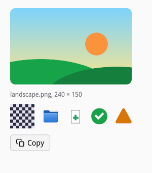

# Images and icons

[examples/images.c](examples/images.c) shows the three sources of
images: files, pixels you make, and the icon theme.



## Images

A `siv_image` is an immutable image the application owns. Image nodes
(`siv_image_view`) and canvases (`siv_draw_image`) show it. A node takes
a reference of its own, and so does every frame that drew the image, so
you may destroy your handle once nodes hold it; a canvas draws by handle,
so keep the handle while a canvas may draw it.

`siv_image_create` copies pixels you made, 8-bit sRGB with straight
alpha:

```c
/* An 8 × 8 checkerboard, drawn scaled up without smoothing. */
static siv_image checkerboard(siv_app app) {
	uint8_t pixels[8 * 8 * 4];
	for (int y = 0; y < 8; y++)
		for (int x = 0; x < 8; x++) {
			uint8_t v = (x + y) % 2 ? 0x2b : 0xe2;
			uint8_t *p = &pixels[(y * 8 + x) * 4];
			p[0] = v, p[1] = v, p[2] = (uint8_t)(v + 0x10), p[3] = 0xff;
		}
	siv_image image = 0;
	siv_result r = siv_image_create(app, SIV_DESC(siv_image_desc, .pixels = pixels, .pixels_count = sizeof pixels, .width = 8, .height = 8), &image);
	if (r != SIV_OK) fprintf(stderr, "images: %s\n", siv_result_name(r));
	return image;
}
```

Shown much larger than its size, an image is smoothed unless the node asks
for the nearest pixel, for pixel art:

```c
siv_image board = checkerboard(app);
siv_node pixels = siv_image_view(txn, row, SIV_DESC(siv_image_view_desc, .image = board, .flags = SIV_IMAGE_NEAREST));
siv_set_layout(txn, pixels, SIV_DESC(siv_layout_desc, .width = {SIV_UNIT_PX, 48}, .height = {SIV_UNIT_PX, 48}));
siv_set_semantics(txn, pixels, SIV_DESC(siv_semantics_desc, .role = SIV_ROLE_NONE));
siv_image_destroy(board);
```

An image node sizes itself to its image unless its layout says otherwise,
and fits the image into its box by `fit`: contain, cover, fill, or none.
`SIV_IMAGE_MIRROR_RTL` mirrors it in right-to-left layouts, for
directional pictures.

## Loading files

`siv_image_load` decodes PNG, APNG, JPEG, GIF, WebP, AVIF, and JPEG XL on
a worker thread, and parses SVG into a vector image that stays sharp at
any size. Give it the largest size the image is shown at and the window's
scale: it decodes straight to that size, so a 24-megapixel photo shown as
a thumbnail costs a thumbnail's memory. Embedded color profiles are
converted:

```c
/* Decoded straight to the size it is shown at, in device pixels. The
 * request could cancel the load or change its priority. */
double scale = 1;
if (siv_window_get_scale(g->window, &scale) != SIV_OK) scale = 1;
siv_image_request request;
return siv_image_load(app, SIV_DESC(siv_image_load_desc, .path = SIV_STR("docs/guide/examples/data/landscape.png"), .max_width = 240, .max_height = 150, .scale = (float)scale), on_loaded, NULL, g, &request);
```

The callback runs on your thread with the image, or with the reason it
failed (`SIV_ERROR_UNSUPPORTED` for an unknown format,
`SIV_ERROR_INVALID_ARGUMENT` for a damaged file, `SIV_ERROR_UNAVAILABLE`
when the file cannot be read):

```c
/* Runs on the application's thread once the file is decoded. The image
 * node takes its own reference, so the handle can go at once. */
static void on_loaded(void *user_data, siv_result result, siv_image image) {
	struct gallery *g = user_data;
	char text[64];
	siv_size size = {0};
	if (result == SIV_OK) result = siv_image_get_size(image, &size);
	if (result == SIV_OK) snprintf(text, sizeof text, "landscape.png, %.0f × %.0f", size.width, size.height);
	else snprintf(text, sizeof text, "Cannot load landscape.png: %s", siv_result_name(result));
	siv_txn txn;
	if (siv_txn_begin(g->window, &txn) == SIV_OK) {
		if (result == SIV_OK) siv_set_image_view(txn, g->photo, SIV_DESC(siv_image_view_desc, .image = image, .fit = SIV_FIT_COVER));
		siv_set_text(txn, g->caption, text, strlen(text));
		commit(txn);
	}
	if (result == SIV_OK) siv_image_destroy(image);
}
```

Until then the node keeps its place, so nothing moves when the image
arrives. To round a photo's corners, put it in a box that clips its
children:

```c
/* Empty until the file arrives; its size keeps its place meanwhile.
 * A frame that clips its children to its rounded corners rounds the
 * photo. */
siv_node frame = siv_box(txn, column);
siv_set_visual(txn, frame, SIV_DESC(siv_visual_desc, .background_token = SIV_COLOR_TOKEN_VIEW_BG, .radius = {10, 10, 10, 10}, .flags = SIV_VISUAL_CLIP));
g->photo = siv_image_view(txn, frame, NULL);
siv_set_layout(txn, g->photo, SIV_DESC(siv_layout_desc, .width = {SIV_UNIT_PX, 240}, .height = {SIV_UNIT_PX, 150}));
```

Loads queue for the compute workers in priority order. The request a load
returns changes its priority (`siv_image_request_set_priority`) or cancels
it (`siv_image_request_cancel`): a cancelled load that has not started
never decodes. A grid of thumbnails asks for what is on screen, newest
first, and cancels what scrolled away, so scrolling past thousands of
photos decodes only those shown.

Image nodes play animations (GIF, APNG, animated WebP and AVIF, JPEG XL),
streaming long ones from the file, unless the user asked for reduced
motion; canvases draw the first frame.

## Icons

Icons come from the desktop's icon theme by name, following the
freedesktop icon theme specification (D19): the user's theme, its parents,
hicolor, then unthemed icons. An image node shows one by name, at a size
in logical pixels:

```c
static void icon(siv_txn txn, siv_node parent, const char *name, siv_color_token color) {
	siv_image_view(txn, parent, SIV_DESC(siv_image_view_desc, .icon = name, strlen(name), .icon_size = 32, .color_token = color));
}
```

```c
/* Themed icons by name: the node follows the desktop's icon theme
 * and loads the icon on a worker thread. Symbolic icons take a
 * color. */
icon(txn, row, "folder", SIV_COLOR_TOKEN_NONE);
icon(txn, row, "document-new", SIV_COLOR_TOKEN_NONE);
icon(txn, row, "emblem-ok-symbolic", SIV_COLOR_TOKEN_SUCCESS);
icon(txn, row, "dialog-warning-symbolic", SIV_COLOR_TOKEN_WARNING);
```

The node takes the icon's size at once and shows it when it loads, follows
theme changes and the window's scale, and in right-to-left layouts prefers
a name's `-rtl` variant. Several names, one per line, try each in turn, and
each name falls back to shorter ones at its dashes (`folder-documents` to
`folder`).

Symbolic icons (names ending in `-symbolic`) are monochrome and take a
color: the node's `color` or `color_token`, by default the text color, so
they follow the theme. Their success, warning, and error parts take the
theme's colors for those.

Buttons, toggle buttons, menu buttons, and menu items take an icon in
their descriptor's `icon` field, drawn in the label's color;
`SIV_WIDGET_ICON_ONLY` hides the label, which stays the accessible name:

```c
siv_push_button(txn, column, SIV_DESC(siv_button_desc, .label = SIV_STR("Copy"), .icon = SIV_STR("edit-copy-symbolic")));
```

Canvases draw icons with `siv_draw_icon` and draw again when one loads.
`siv_icon_load` delivers an icon as a `siv_image`, for the tray or a drag
icon; such an image does not follow later theme changes.

An application's own icons go in a directory added with
`siv_app_add_icon_path`, as a theme (`hicolor/scalable/apps/org.example.App.svg`)
or as files named after the icon, and are found before the system's.
`siv_app_set_icon_theme` fixes the theme instead of following the
desktop's.
