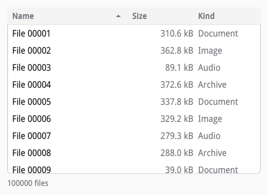
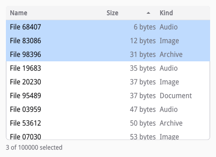
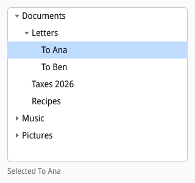

# Lists, tables, and trees

siv's views (`siv_list_view`, `siv_table_view`, `siv_tree_view`,
`siv_grid_view`) are virtualized: only the rows in view, plus a few beyond,
exist as nodes. You give the number of items and a `bind` callback that
fills a row; as the user scrolls, rows that leave the view are recycled for
items that enter it. A list of millions costs what is on screen, and the
compositor scrolls it like any scroll node.

[examples/table.c](examples/table.c) shows 100 000 files:



## Binding rows

A view's descriptor has the item count, a fixed row height (`item_height`,
or a `height` callback for rows of different heights), the selection mode,
an accessible label, and the callbacks with their `user_data` and
destroy-notify:

```c
m->table = siv_table_view(txn, column, SIV_DESC(siv_view_desc, .label = S("Files"), .user_data = m, .bind = bind, .count = COUNT, .item_height = 28, .selection = SIV_SELECTION_MODE_MULTIPLE));
siv_set_layout(txn, m->table, SIV_DESC(siv_layout_desc, .grow = 1, .basis = {SIV_UNIT_PX, 0}));
siv_set_visual(txn, m->table, SIV_DESC(siv_visual_desc, .background_token = SIV_COLOR_TOKEN_VIEW_BG, .border_token = SIV_COLOR_TOKEN_BORDER, .border_width = 1, .radius = {6, 6, 6, 6}, .flags = SIV_VISUAL_CLIP));
siv_table_column(txn, m->table, SIV_DESC(siv_column_desc, .title = S("Name"), .width = {SIV_TRACK_UNIT_FR, 2}, .flags = SIV_COLUMN_SORTABLE));
siv_table_column(txn, m->table, SIV_DESC(siv_column_desc, .title = S("Size"), .width = {SIV_TRACK_UNIT_PX, 100}, .flags = SIV_COLUMN_SORTABLE));
siv_table_column(txn, m->table, SIV_DESC(siv_column_desc, .title = S("Kind"), .width = {SIV_TRACK_UNIT_FR, 1}, .flags = SIV_COLUMN_SORTABLE));
siv_view_set_sort(txn, m->table, 0, SIV_SORT_ASCENDING);
```

`bind` runs inside the view's transaction for each row coming into view:
add or change nodes under `row` with that transaction, and do not open
another. A recycled row still holds what an earlier bind put there for
another item, so a bind makes the row's nodes the first time and only
updates them afterwards. Rows of a table are grids with the columns'
tracks, one cell per column:

```c
/* Fills a row with its cells the first time, then only updates them: a
 * recycled row still holds the cells an earlier bind made. Rows of a
 * table are grids with the columns' tracks, one cell per column. */
static void bind(void *user_data, siv_txn txn, siv_node row, uint64_t item, uint32_t index, uint32_t depth, bool recycled) {
	(void)index;
	(void)depth;
	struct model *m = user_data;
	const struct file *f = &m->files[m->order[item]];
	if (!recycled) {
		for (uint32_t column = 1; column <= 3; column++) {
			siv_node text = siv_text(txn, row, NULL, 0);
			siv_set_text_style(txn, text, SIV_DESC(siv_text_style_desc, .color_token = column == 1 ? SIV_COLOR_TOKEN_VIEW_FG : SIV_COLOR_TOKEN_MUTED_FG, .align = column == 2 ? SIV_TEXT_ALIGN_END : SIV_TEXT_ALIGN_START, .flags = SIV_TEXT_NO_WRAP | SIV_TEXT_ELLIPSIZE));
			siv_set_semantics(txn, text, SIV_DESC(siv_semantics_desc, .role = SIV_ROLE_CELL, .column = column));
		}
	}
	siv_node cell = related(row, SIV_RELATION_FIRST_CHILD);
	char name[32], size[32];
	snprintf(name, sizeof name, "File %05u", (unsigned)f->number);
	if (f->size < 1000) snprintf(size, sizeof size, "%u bytes", (unsigned)f->size);
	else snprintf(size, sizeof size, "%u.%u kB", (unsigned)(f->size / 1000), (unsigned)(f->size % 1000 / 100));
	const char *texts[] = {name, size, kinds[f->kind]};
	for (int i = 0; i < 3 && cell; i++, cell = related(cell, SIV_RELATION_NEXT)) siv_set_text(txn, cell, S(texts[i]));
}
```

Rows are placed by arithmetic, never measured, which is what keeps
scrolling a long view cheap: give every row `item_height`, or let the
`height` callback size each one (measuring text with
`siv_app_measure_text` if rows wrap). When items change, `siv_view_set_count`
sets a new count and `siv_view_refresh` binds the rows in view again.

## Selection and the cursor

A view has a cursor, the row that has focus and that keys move from
(roving focus: the view is one Tab stop), and a selection: none, single,
or multiple, with Ctrl, Shift, and Ctrl+A. Up, Down, Page Up, Page Down,
Home, and End move the cursor and keep it in view; Space and clicks
select; Enter and double clicks report `SIV_EVENT_TYPE_ACTIVATE` with the
row's index.

Selection changes report `SIV_EVENT_TYPE_SELECT` with the cursor's
`index`, the `count` of selected items, and `changed_index` and
`changed_count`, a range that holds every item whose selection changed, so
a handler keeping totals reads only that much:

```c
static siv_event_result on_select(void *user_data, siv_node table, const siv_event *event) {
	(void)table;
	char text[64];
	snprintf(text, sizeof text, "%u of %u selected", (unsigned)event->count, COUNT);
	set_status(user_data, text);
	return SIV_EVENT_RESULT_HANDLED;
}
```



`siv_view_get_selection` and `siv_view_set_selection` read and replace the
whole selection as a bitset in one call, which keeps select-all fast on a
million items; `siv_view_set_selected` changes one. `siv_view_get_cursor` and
`siv_view_set_cursor` read and move the cursor, `siv_node_focus` on the
view focuses its cursor row, and
`siv_view_get_row` returns the node bound for a row, to open a context menu
at it (`siv_menu_open_at`). A press on an item of a larger selection keeps
the selection, so a drag carries all of it.

Rows report their position among all items and the set's size to screen
readers by themselves, since most of their siblings have no node. Rows
take their accessible name from their text; table cells should carry the
`cell` role and their column, as the bind above does.

## Tables

`siv_table_column` adds a column with a title, a track width (`fr` shares
or pixels), a least width, and flags. Users resize columns by dragging the
handle at a header's end or with Ctrl+Left and Ctrl+Right on a focused
header. Header cells are widgets whose value is the column's width: a
resize reports `SIV_EVENT_TYPE_CHANGE` on the header cell, and
`siv_widget_get_value` and `siv_widget_set_value` on it read and set the
width (`siv_widget_get_part` with `SIV_WIDGET_PART_COLUMN` finds a header
cell by index).

A sortable column's header reports `SIV_EVENT_TYPE_SORT` when clicked, or
Enter or Space on it, with the column and the direction. The view sorts
nothing itself: sort your items, return handled so the header shows the
order (it never claims one your items lack), and bind again:

```c
static siv_event_result on_sort(void *user_data, siv_node table, const siv_event *event) {
	struct model *m = user_data;
	sort_files = m->files;
	sort_column = (int)event->index;
	sort_sign = event->value > 0 ? 1 : -1;
	qsort(m->order, COUNT, sizeof *m->order, compare);
	siv_txn txn;
	if (siv_txn_begin(event->window, &txn) != SIV_OK) return SIV_EVENT_RESULT_PASS;
	siv_view_refresh(txn, table);
	return siv_txn_commit(txn) == SIV_OK ? SIV_EVENT_RESULT_HANDLED : SIV_EVENT_RESULT_PASS;
}
```

`siv_view_set_sort` shows an order without a report, for the initial one.

## Trees

A tree view asks for children only as items become visible: `children`
counts an item's children and `child` returns a child's id, nonzero and
unique; 0 is the top level. `bind` gets the item's id and its depth, and
the view indents rows, draws disclosure triangles, and reports levels to
screen readers. Right expands an item or moves to its first child, Left
collapses it or moves to its parent. In Lua, from
[examples/tree.lua](examples/tree.lua):

```lua
local view = txn:tree_view(column, {
	label = "Folders",
	selection = "single",
	item_height = 28,
	children = function(id)
		return #children(id)
	end,
	child = function(id, index)
		return children(id)[index + 1].id
	end,
	-- A new row gets a text node; a recycled one already has it.
	bind = function(t, row, id, _, _, recycled)
		if not recycled then
			t:text(row, "", { text_style = { color_token = "view_fg" } })
		end
		t:set_text(row:get_related("first_child"), items[id][1])
	end,
}, {
```

The view's `select` handler turns a row index into an item with
`view_get_item`:

```lua
select = function(node, ev)
	local id = node:view_get_item(ev.index)
	win:update(function(t)
		t:set_text(status, "Selected " .. items[id][1])
	end)
	return true
end,
```



`siv_view_set_expanded` expands and collapses items from code.

## Grids

A grid view lays out cells of `item_width` by `item_height`, as many per
row as fit, in reading order (mirrored right to left), with arrow keys in
two dimensions. It is the view for thumbnails; pair it with image loads
whose priorities follow the scroll position (see
[Images and icons](07-images-and-icons.md#loading-files)).
