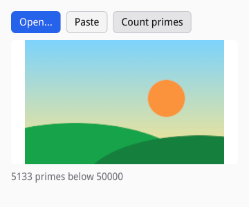

# Work off the UI thread

Your thread runs handlers, layout, and painting between frames. Work that
takes longer than a few milliseconds there delays input and new content
(the compositor keeps scrolling and animating, but shows nothing new). siv
does its own slow work elsewhere already: fonts, images, and icons load on
worker threads, and D-Bus and the portals are asynchronous. This chapter
covers yours.

## Jobs

`siv_job_start` runs a function on siv's worker pool, then a `done`
function on your thread at a safe point, then the destroy-notify (D6).
Jobs share the pool with siv's image decoding and rendering, so they never
oversubscribe the CPU against them. [examples/jobs.c](examples/jobs.c)
counts primes:


```c
/* One job: what the worker reads and writes. It belongs to the job until
 * destroy runs; the UI reaches it only from done and posted callbacks. */
struct count_job {
	struct ui *ui;
	atomic_bool cancelled;
	uint32_t found;
};
```

The work runs on a worker thread, where the only siv call allowed is
`siv_post`; it reports progress with it:

```c
/* On a worker thread: it may call siv_post and nothing else of siv's. */
static void count_primes(void *user_data) {
	struct count_job *job = user_data;
	for (uint32_t n = 0; n < LIMIT; n++) {
		if (n % (LIMIT / 20) == 0) {
			if (atomic_load(&job->cancelled)) return;
			struct progress *p = malloc(sizeof *p);
			if (p) {
				*p = (struct progress){job->ui, (double)n / LIMIT};
				if (siv_post(job->ui->app, show_progress, free, p) != SIV_OK) free(p);
			}
		}
		if (is_prime(n)) job->found++;
	}
}
```

Blocking work (reading files, the network) is the default and runs on a
lane of threads of its own, so a slow disk never holds a thread that
decoding or rendering needs. CPU-bound work asks for the compute workers
with `SIV_JOB_COMPUTE`:

```c
/* CPU-bound work goes to the compute workers; blocking work (files,
 * the network) leaves the flag off. */
if (siv_job_start(ui->app, SIV_JOB_COMPUTE, count_primes, count_done, count_destroy, job) != SIV_OK) return SIV_EVENT_RESULT_HANDLED;
running = job;
```

`done` runs on your thread after the work returned, and may change the
tree:

```c
/* Back on the application's thread, after the work returned. */
static void count_done(void *user_data) {
	struct count_job *job = user_data;
	struct ui *ui = job->ui;
	char text[64];
	if (atomic_load(&job->cancelled)) snprintf(text, sizeof text, "Cancelled");
	else snprintf(text, sizeof text, "%u primes below %u", (unsigned)job->found, LIMIT);
	siv_txn txn;
	if (siv_txn_begin(ui->window, &txn) != SIV_OK) return;
	siv_set_text(txn, ui->result, text, strlen(text));
	siv_widget_set_value(txn, ui->progress, atomic_load(&job->cancelled) ? 0 : 100);
	set_running(ui, txn, false);
	commit(txn);
}
```

A running job cannot be stopped from outside; long work checks a flag of
its own, as the sample's Cancel does. Destroying the application waits for
running jobs and drops queued ones, whose destroy-notify still runs, so
free in the destroy-notify, not in `done`.

Threads of your own hand results to your thread with `siv_post`, the one
call safe from any thread (see [How siv works](02-model.md#callbacks-at-safe-points)).

## File descriptors

A program that waits on a descriptor of its own (a pipe, a socket, an
inotify instance) adds it to siv's loop with `siv_app_watch_fd` instead of
blocking a thread on it. The callback runs on your thread when the
descriptor is ready. Watches are level-triggered: read until the
descriptor would block, or the callback runs again next iteration.
[examples/watch.c](examples/watch.c) reads a child process's output:

```c
/* Level-triggered: read until the pipe would block, or this runs again in
 * the next loop iteration. */
static void on_readable(void *user_data, siv_watch watch, siv_watch_flags events) {
	struct log *log = user_data;
	for (;;) {
		char chunk[512];
		ssize_t n = read(log->fd, chunk, sizeof chunk);
		if (n > 0) {
			for (ssize_t i = 0; i < n; i++) log->lines += chunk[i] == '\n';
			size_t room = sizeof log->buf - log->len;
			size_t take = (size_t)n < room ? (size_t)n : room;
			memcpy(log->buf + log->len, chunk, take);
			log->len += take;
			continue;
		}
		if (n < 0 && errno == EAGAIN && !(events & SIV_WATCH_HANGUP)) break;
		/* End of output: stop watching before closing the descriptor. */
		siv_watch_destroy(watch);
		close(log->fd);
		waitpid(log->child, NULL, 0);
		char status[64];
		snprintf(status, sizeof status, "Done: %u lines", log->lines);
		update(log, status);
		return;
	}
	update(log, NULL);
}
```


siv never owns the descriptor: destroy the watch before closing it.
`siv_watch_set_events` changes what a watch waits for, such as writable
only while there is something to write.

## Portals

Desktop services go through xdg-desktop-portal, which works the same
inside Flatpak and out (D19): the file chooser, opening URIs and files in
other applications (`siv_open_uri`), notifications (`siv_notification_send`),
screenshots and color picking, keeping the session awake
(`siv_inhibit`), global shortcuts, screen casts, and the document portal.
siv has no file chooser of its own; the portal's is the system's.

One-shot requests take a `siv_portal_fn`, which gets a `siv_portal_result`
whose `response` says how it ended: success, cancelled by the user, ended
by the desktop, unavailable (no portal, or no session bus), or failed.
Requests with more to them, the file chooser among them, are handles that
you set up and show; their callback runs, then getters read the result.
The callback never runs inside the call that started the request, even
when the answer is immediate, so code after the call runs first.

Notification buttons invoke application actions, registered with
`siv_app_add_action`; the desktop can invoke them too (see
[Packaging](15-packaging.md)).

## Coroutines in Lua

A Lua state runs only on the application's thread. In a coroutine started
with `siv.spawn`, a call that takes a callback (image loads, portal
requests, clipboard reads, jobs) waits for its result when given none, and
`app:sleep(ms)` waits on a timer. The code reads top to bottom while your
thread keeps running.
[examples/async.lua](examples/async.lua):

```lua
-- The desktop's file chooser, through the portal: show waits until the
-- user answers.
local function open()
	local chooser <close> = app:file_chooser_create{ title = "Open an image" }
	chooser:add_filter("Images")
	chooser:add_pattern("mime", "image/*")
	local result = chooser:show(win)
	if result.response == "success" then
		show(chooser:get_path(0))
	else
		say("No image chosen (" .. result.response .. ")")
	end
end
```

A failed request raises a siv error inside the coroutine, so a `pcall`
handles it like any error:

```lua
-- Decodes on a worker thread; a failed load raises, so pcall catches it.
local function show(path)
	say("Loading " .. path:match("[^/]*$"))
	local ok, image = pcall(app.image_load, app, { path = path, max_width = 320, max_height = 180 })
	if not ok then
		say("Cannot load it: " .. tostring(image))
		return
	end
	local size = image:get_size()
	win:update(function(txn)
		txn:set_image_view(view, { image = image, fit = "contain" })
		txn:set_text(status, ("%s, %d × %d"):format(path:match("[^/]*$"), size.width, size.height))
	end)
end
```

Handlers start coroutines and return at once:

```lua
-- Handlers return at once; the coroutine runs until it waits.
txn:push_button(bar, { label = "Open…", style = "primary" }, {
	on = { activate = function()
		siv.spawn(open)
		return true
	end },
})
```

```lua
-- A sequence with waits in it: a timer, then a decode.
siv.spawn(function()
	app:sleep(100)
	show("docs/guide/examples/data/landscape.png")
end)
```

CPU-bound work goes to the worker pool with `app:job_start(flags, work,
args, done)`, as `siv_job_start` does in C. `work` runs in a fresh Lua
state of its own on a worker, with the base, string, table, math, and utf8
libraries and nothing of siv's: it gets copies of `args` and its results
come back as copies (nil, booleans, numbers, strings, and tables of them).
It cannot use locals from outside it, and a function that does is refused
with the local's name, so pass what it needs in `args`. In a coroutine,
without `done`, the call waits and returns the results; a job that raises
raises there:

```lua
-- CPU-bound work runs on the worker pool, in a Lua state of its own: it
-- sees its arguments and the standard libraries, not this file's locals,
-- and its results come back as copies.
local function count_primes(limit)
	local n = 0
	for i = 2, limit - 1 do
		local prime = true
		for d = 2, math.floor(math.sqrt(i)) do
			if i % d == 0 then
				prime = false
				break
			end
		end
		if prime then n = n + 1 end
	end
	return n
end

local function count()
	say("Counting…")
	local n = app:job_start("compute", count_primes, { 50000 })
	say(("%d primes below 50000"):format(n))
end
```

Given `done`, the call returns at once and `done(true, results...)` or
`done(false, message)` runs at a safe point. Each job starts a Lua state
and copies its data both ways, so give it work that takes milliseconds,
not microseconds.



Outside a coroutine, an asynchronous call needs its callback, and raises
without one. An error in a callback or coroutine ends `app:run()` with its
traceback, unless `siv.set_error_handler` takes it.

### Hot reload

`siv-lua --watch app.lua` runs the program again in the running
application when it or a module it required changes. Windows and state
made inside `siv.keep(key, make)` survive the reload; the rest of the
program runs again and rebuilds what it shows from them, so you see an
edit to a layout or a handler without restarting.
[examples/todo.lua](../../examples/todo.lua) in the repository keeps its
window, items, and draft this way.
