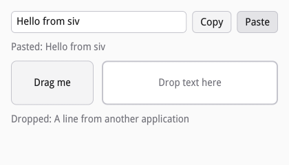

# Clipboard and drag and drop

Editors copy, cut, paste, and take dropped text by themselves, including
the primary selection (select to copy, middle-click to paste). This
chapter is for everything else. [examples/clipboard.c](examples/clipboard.c)
copies and pastes with buttons, drags a note out, and takes text dropped
from any application:



## Copy and paste

Wayland gives an application the clipboard only in answer to user input,
so `siv_clipboard_write` belongs in a key, pointer, or activate handler.
siv keeps a copy of the text and writes it to whoever pastes, other
applications included:

```c
/* Copy: Wayland hands out the clipboard only in answer to input, so this
 * runs from the button's activate handler. */
static siv_event_result on_copy(void *user_data, siv_node button, const siv_event *event) {
	(void)button;
	struct ui *ui = user_data;
	char text[256];
	size_t len = 0;
	if (siv_node_get_text(ui->field, text, sizeof text, &len) != SIV_OK) return SIV_EVENT_RESULT_PASS;
	if (len > sizeof text) len = sizeof text;
	siv_result r = siv_clipboard_write(event->window, SIV_SELECTION_CLIPBOARD, text, len);
	return r == SIV_OK ? SIV_EVENT_RESULT_HANDLED : SIV_EVENT_RESULT_PASS;
}
```

`siv_clipboard_read` pastes. The text arrives later, at a safe point,
never inside the call, as valid UTF-8; NULL means the clipboard held no
text, the transfer failed, or it passed the transfer limit (16 MiB by
default, `siv_app_set_transfer_limit`):

```c
/* Paste: the text arrives later, in the dispatch phase, never inside
 * siv_clipboard_read. NULL means the clipboard held no text. */
static void on_pasted(void *user_data, const char *text, size_t len) {
	struct ui *ui = user_data;
	char line[300];
	int n = text ? snprintf(line, sizeof line, "Pasted: %.*s", (int)len, text) : snprintf(line, sizeof line, "Nothing to paste");
	set_text(ui, ui->pasted, line, (size_t)n < sizeof line ? (size_t)n : sizeof line - 1);
}
```

```c
static siv_event_result on_paste(void *user_data, siv_node button, const siv_event *event) {
	(void)button;
	siv_result r = siv_clipboard_read(event->window, SIV_SELECTION_CLIPBOARD, on_pasted, NULL, user_data);
	return r == SIV_OK ? SIV_EVENT_RESULT_HANDLED : SIV_EVENT_RESULT_PASS;
}
```

Both take `SIV_SELECTION_PRIMARY` instead for the primary selection. Other
MIME types go through `siv_clipboard_write_data`, which offers data in
several types at once (one per line in `mimes`, split by `lengths`), and
`siv_clipboard_read_data`, which takes the first of the types you name
that the clipboard offers. A file manager copies files as `text/uri-list`
this way.

## Dragging out

A drag starts from a pointer handler while the button is held, typically
once the pointer moved a few pixels. `siv_drag_start` takes the data in
one or more MIME types, the actions allowed (copy, move, ask), and an
optional icon image:

```c
/* A drag starts once the pointer moved a few pixels with the button held. */
static siv_event_result on_tile_pointer(void *user_data, siv_node tile, const siv_event *event) {
	struct ui *ui = user_data;
	if (event->phase == SIV_POINTER_PHASE_DOWN && event->button == SIV_POINTER_BUTTON_PRIMARY) {
		ui->pressed = true;
		ui->press_x = event->x, ui->press_y = event->y;
	} else if (event->phase == SIV_POINTER_PHASE_UP || event->phase == SIV_POINTER_PHASE_CANCEL) {
		ui->pressed = false;
	} else if (event->phase == SIV_POINTER_PHASE_MOVE && ui->pressed && hypotf(event->x - ui->press_x, event->y - ui->press_y) > 4) {
		ui->pressed = false;
		const char *note = "A note dragged from siv";
		siv_result r = siv_drag_start(tile, SIV_DESC(siv_drag_desc, .mimes = S(TEXT_MIME), .data = (const uint8_t *)note, .data_count = strlen(note), .actions = SIV_DRAG_ALLOW_COPY));
		return r == SIV_OK ? SIV_EVENT_RESULT_HANDLED : SIV_EVENT_RESULT_PASS;
	}
	return SIV_EVENT_RESULT_PASS;
}
```

The node that had the press gets a pointer cancel, and the dragging node
gets `SIV_EVENT_TYPE_DRAG` events as the drag goes: the target under the
pointer and whether it takes the data, the drop, and the end with the
action performed. After a move, delete the data. `SIV_DRAG_IN_APP` keeps
the data inside the application, for reordering.

## Dropping in

A drop target is a node with `siv_set_drop_target`: the MIME types it
takes, preferred first, and its actions. A drag goes to the nearest target
under the pointer whose types and actions meet the drag's, and to no
other: drop events do not bubble.

```c
siv_set_drop_target(txn, ui->target, SIV_DESC(siv_drop_target_desc, .mimes = S(TEXT_MIME "\ntext/plain"), .actions = SIV_DRAG_ALLOW_COPY));
siv_on(txn, ui->target, SIV_EVENT_TYPE_DROP, on_drop, NULL, ui);
```

The target's drop handler hears the drag enter, move, leave, and drop.
Returning true from enter or move takes the drag (the source then sees an
accepting target); on a drop, siv has already read the whole payload in
the node's type, and `data` holds it:

```c
/* Drops do not bubble: the nearest target under the pointer decides.
 * Returning true from enter or move takes the drag; from drop, the data. */
static siv_event_result on_drop(void *user_data, siv_node target, const siv_event *event) {
	(void)target;
	struct ui *ui = user_data;
	switch (event->phase) {
	case SIV_POINTER_PHASE_ENTER:
		highlight(ui, true);
		return SIV_EVENT_RESULT_HANDLED;
	case SIV_POINTER_PHASE_MOVE:
		return SIV_EVENT_RESULT_HANDLED;
	case SIV_POINTER_PHASE_LEAVE:
		highlight(ui, false);
		return SIV_EVENT_RESULT_PASS;
	case SIV_POINTER_PHASE_DROP: {
		highlight(ui, false);
		char line[300];
		int n = snprintf(line, sizeof line, "Dropped: %.*s", (int)event->data_count, (const char *)event->data);
		set_text(ui, ui->dropped, line, (size_t)n < sizeof line ? (size_t)n : sizeof line - 1);
		return SIV_EVENT_RESULT_HANDLED;
	}
	default:
		return SIV_EVENT_RESULT_PASS;
	}
}
```

With the `ask` action, the application asks the user after the drop and
then calls `siv_drop_finish` with copy, move, or none.
