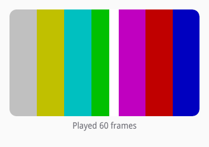

# External surfaces and video

Some content is rendered outside siv: video from a decoder, a 3D view in
Vulkan or OpenGL, frames from GStreamer or libmpv. siv shows it in an
external node, which sits in the tree, lays out, clips, and stacks like
any node (D17). The content comes from a slot (`siv_external`) of one of
two kinds:

- A **frame slot** (`siv_external_create`) takes frames you submit, in
  shared memory or as dma-bufs.
- A **surface slot** (`siv_external_create_surface`) gives you a
  `wl_surface` to render into with your own EGL, Vulkan, or GStreamer.

Either way siv lets the Wayland compositor show the content on a
subsurface of its own, without a copy, when it can: the node is
axis-aligned, opaque, and clipped only by rectangles. When it cannot (a
rounded clip, a rotation, translucency), siv draws the content into the
window instead, through Vulkan for dma-bufs.

## Frame slots

[examples/video.c](examples/video.c) plays a test pattern from a producer
thread, as a video decoder would:



The slot belongs to a window, and an external node shows it with an
intrinsic size (the content's size or aspect ratio) and a fit:

```c
/* The slot belongs to the window; the release callback makes buffers
 * come back on the compositor thread rather than as events. */
siv_result r = siv_external_create(p->window, SIV_DESC(siv_external_desc, .user_data = p, .release = on_release), &p->slot);
siv_txn txn;
if (r == SIV_OK) r = siv_txn_begin(p->window, &txn);
if (r != SIV_OK) return r;
siv_node root = siv_window_get_root(p->window);
siv_set_visual(txn, root, SIV_DESC(siv_visual_desc, .background_token = SIV_COLOR_TOKEN_WINDOW_BG));
siv_node column = siv_flex(txn, root, SIV_DESC(siv_flex_desc, .axis = SIV_AXIS_COLUMN, .gap = 8, .align_items = SIV_ALIGN_CENTER));
siv_set_layout(txn, column, SIV_DESC(siv_layout_desc, .width = {SIV_UNIT_FRACTION, 1}, .padding = {16, 16, 16, 16}));
/* Unclipped and uncovered, the frames go to a subsurface of their
 * own, without a copy. Rounded corners need composition: siv draws
 * the frame into the window instead. */
siv_node frame = siv_box(txn, column);
siv_set_visual(txn, frame, SIV_DESC(siv_visual_desc, .radius = {12, 12, 12, 12}, .flags = SIV_VISUAL_CLIP));
siv_node view = siv_external_view(txn, frame, SIV_DESC(siv_external_view_desc, .external = p->slot, .content_size = {WIDTH, HEIGHT}, .fit = SIV_FIT_CONTAIN));
```

Frames go straight to siv's compositor thread from any thread, so playback
never waits for your application's thread. A frame names its pixels by an
fd siv can map (a memfd here), an offset, a size, and a `key` that changes
whenever the pixels do:

```c
/* The key names the pixels: it comes back in on_release. */
siv_external_frame_desc frame = {.size = sizeof frame, .key = (uint64_t)n, .fd = p->fd, .offset = (uint32_t)(buffer * FRAME_BYTES), .width = WIDTH, .height = HEIGHT};
if (siv_external_submit(p->slot, &frame) != SIV_OK) break;
```

A submitted frame's memory must not change until siv releases it, which it
reports by key once no frame on screen reads it. With a `release`
callback, releases arrive on the compositor thread, so a producer recycles
its buffers however busy your thread is; the callback must be quick and
may call only `siv_external_submit` and `siv_post`:

```c
/* Runs on siv's compositor thread when no frame reads the buffer any
 * more: quick, and only siv_external_submit and siv_post are allowed. */
static void on_release(void *user_data, siv_external slot, uint64_t key) {
	(void)slot;
	struct player *p = user_data;
	pthread_mutex_lock(&p->lock);
	p->busy[key % 2] = false;
	pthread_cond_signal(&p->released);
	pthread_mutex_unlock(&p->lock);
}
```

Without a `release` callback, releases arrive as
`SIV_EXTERNAL_EVENT_TYPE_RELEASED` events on your thread instead.

Dma-buf frames (`SIV_EXTERNAL_MEMORY_DMABUF`) take a DRM format and
modifier and up to four planes; a frame shows once its implicit fences
signal, so neither siv nor the compositor waits on your GPU. The Wayland
compositor shows YUV and tiled buffers directly when it supports their
format; otherwise siv's Vulkan renderer imports them.

## Surface slots

A surface slot hands you siv's `wl_display` and a `wl_surface`
(`siv_external_get_wayland`) to render into yourself. The contract, which
`siv_external_create_surface`'s reference spells out:

- Render frames of the buffer size each `SIV_EXTERNAL_EVENT_TYPE_CONFIGURE`
  event gives (the node's size times the window's scale), and one soon
  after each configure even if nothing else changed.
- After committing a frame, call `siv_external_surface_committed` with its
  size, from any thread; the window's next commit shows it, and only then
  does the surface's frame callback fire, so a swap interval of 1 paces
  itself to siv's frames.
- Use the display only through an event queue of your own
  (`wl_display_create_queue`), as Mesa's EGL and Vulkan do, and never
  dispatch its default queue: siv's compositor thread owns it.
- Never set a viewport, buffer scale, or listener on the surface; siv
  positions, scales, and clips it.

The headless backend has no Wayland objects, so surface slots return NULL
pointers there; test with frame slots.
