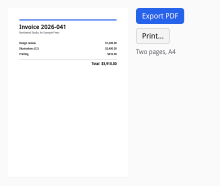

# Printing and PDF

siv prints and writes PDF from the same drawing calls as a canvas (D19).
A document is a `siv_print_desc`: a title, a `draw_page` callback, the page
count (or a `begin` callback that lays the document out for the paper and
returns the count), and a `done` callback. Pass it to `siv_pdf_write` to
write a PDF to a file descriptor, or to `siv_print` to show the system's
print dialog, through the Print portal, and hand the printer a PDF.

[examples/print.c](examples/print.c) previews an invoice on a canvas and
prints or exports the same pages:



## Drawing pages

`draw_page` draws one page in points (1/72 inch), y down from the top
left, with the `siv_draw_*` calls a canvas uses. The page setup gives the
paper size and the margins the printer or the user chose:

```c
/* Draws one page in points, y down from the top-left corner. Page 0 is
 * the invoice, page 1 its terms. */
static void draw_page(void *user_data, siv_draw d, uint32_t page, const siv_page_setup *setup) {
	(void)user_data;
	float x = setup->margin_left, y = setup->margin_top;
	float w = setup->width - setup->margin_left - setup->margin_right;
	siv_color ink = {0.1f, 0.1f, 0.12f, 1}, muted = {0.45f, 0.45f, 0.5f, 1}, accent = {0.15f, 0.39f, 0.92f, 1};
	if (page == 1) {
		siv_draw_text(d, x, y, w, S("Terms"), SIV_DESC(siv_text_style_desc, .font_size = 20, .weight = SIV_FONT_WEIGHT_BOLD, .color = ink));
		siv_draw_text(d, x, y + 36, w, S("Payment is due within 30 days. Thank you for your business."), SIV_DESC(siv_text_style_desc, .font_size = 12, .color = ink));
		return;
	}
	siv_draw_rect(d, (siv_rect){x, y, w, 6});
	siv_draw_fill(d, SIV_DESC(siv_paint_desc, .color = accent), 0);
	siv_draw_text(d, x, y + 20, w, S("Invoice 2026-041"), SIV_DESC(siv_text_style_desc, .font_size = 28, .weight = SIV_FONT_WEIGHT_BOLD, .color = ink));
	siv_draw_text(d, x, y + 60, w, S("Northwind Studio, for Example Press"), SIV_DESC(siv_text_style_desc, .font_size = 12, .color = muted));
	float row = y + 110;
	for (size_t i = 0; i < 3; i++, row += 28) {
		siv_draw_text(d, x, row, w, S(items[i][0]), SIV_DESC(siv_text_style_desc, .font_size = 13, .color = ink));
		siv_draw_text(d, x, row, w, S(items[i][1]), SIV_DESC(siv_text_style_desc, .font_size = 13, .color = ink, .align = SIV_TEXT_ALIGN_END));
	}
	siv_draw_move_to(d, x, row + 4);
	siv_draw_line_to(d, x + w, row + 4);
	siv_draw_stroke(d, SIV_DESC(siv_stroke_desc, .width = 1), SIV_DESC(siv_paint_desc, .color = muted));
	siv_draw_text(d, x, row + 16, w, S("Total  $3,910.00"), SIV_DESC(siv_text_style_desc, .font_size = 16, .weight = SIV_FONT_WEIGHT_BOLD, .color = ink, .align = SIV_TEXT_ALIGN_END));
}
```

Text keeps its characters, so the PDF is searchable and copyable, with
font subsets embedded. Pages use the light theme's colors (paper is white)
and ignore the desktop's text scale. Text drawn while a font is still
loading draws every page again once it loads. Pages are drawn at a later
dispatch, never inside the call.

Since `draw_page` is just drawing, the preview reuses it on a canvas,
scaled to fit:

```c
/* The preview: the same page, scaled to the canvas. */
static void draw_preview(void *user_data, siv_node node, siv_draw d, float width, float height) {
	(void)node;
	(void)height;
	float scale = width / A4_WIDTH;
	siv_draw_rect(d, (siv_rect){0, 0, width, A4_HEIGHT * scale});
	siv_draw_fill(d, SIV_DESC(siv_paint_desc, .color = {1, 1, 1, 1}), 0);
	siv_draw_push_transform(d, (siv_affine){.a = scale, .d = scale});
	siv_page_setup a4 = {.size = sizeof a4, .width = A4_WIDTH, .height = A4_HEIGHT, .margin_top = 56, .margin_right = 56, .margin_bottom = 56, .margin_left = 56};
	draw_page(user_data, d, 0, &a4);
	siv_draw_pop(d);
}
```

## Writing a PDF

`siv_pdf_write` duplicates the descriptor, draws the pages at the next
dispatch, and writes them (A4 unless the descriptor gives a size); `done`
reports success with the page count, or failure:

```c
static siv_event_result on_export(void *user_data, siv_node button, const siv_event *event) {
	(void)button;
	(void)event;
	struct doc *doc = user_data;
	const char *dir = getenv("TMPDIR");
	snprintf(doc->path, sizeof doc->path, "%s/invoice.pdf", dir && *dir ? dir : "/tmp");
	int fd = open(doc->path, O_WRONLY | O_CREAT | O_TRUNC | O_CLOEXEC, 0644);
	if (fd < 0) return SIV_EVENT_RESULT_PASS;
	/* siv duplicates the descriptor; pages are drawn at the next dispatch. */
	siv_result r = siv_pdf_write(doc->app, SIV_DESC(siv_print_desc, .title = S("Invoice 2026-041"), .user_data = doc, .draw_page = draw_page, .done = on_exported, .page_count = 2, .margin = 56), fd);
	close(fd);
	return r == SIV_OK ? SIV_EVENT_RESULT_HANDLED : SIV_EVENT_RESULT_PASS;
}
```

A real application asks where to save with a file chooser in
`SIV_FILE_CHOOSER_MODE_SAVE` (see [Work off the UI thread](09-async.md#portals));
the sample writes to the temporary directory.

## Printing

`siv_print` shows the system's print dialog, then lays the document out for
the page setup the dialog returns (calling `begin` if you gave one) and
sends the pages to the print system, which applies copies, page ranges,
and pages per sheet itself:

```c
/* The system's dialog chooses the printer and the paper; the document is
 * laid out for its page setup and handed over as PDF. */
static siv_event_result on_print(void *user_data, siv_node button, const siv_event *event) {
	(void)button;
	struct doc *doc = user_data;
	siv_result r = siv_print(doc->app, event->window, SIV_DESC(siv_print_desc, .title = S("Invoice 2026-041"), .user_data = doc, .draw_page = draw_page, .done = on_printed, .page_count = 2));
	return r == SIV_OK ? SIV_EVENT_RESULT_HANDLED : SIV_EVENT_RESULT_PASS;
}
```

`done` hears how it ended: sent, cancelled by the user, or unavailable
when no print portal runs:

```c
static void on_printed(void *user_data, const siv_portal_result *result) {
	struct doc *doc = user_data;
	switch (result->response) {
	case SIV_PORTAL_RESPONSE_SUCCESS: set_status(doc, "Sent to the printer"); break;
	case SIV_PORTAL_RESPONSE_CANCELLED: set_status(doc, "Printing cancelled"); break;
	case SIV_PORTAL_RESPONSE_UNAVAILABLE: set_status(doc, "No print portal on this system"); break;
	default: set_status(doc, "Printing failed"); break;
	}
}
```

The document's language and direction default to the window's, for
shaping and for aligning text as the window does.
